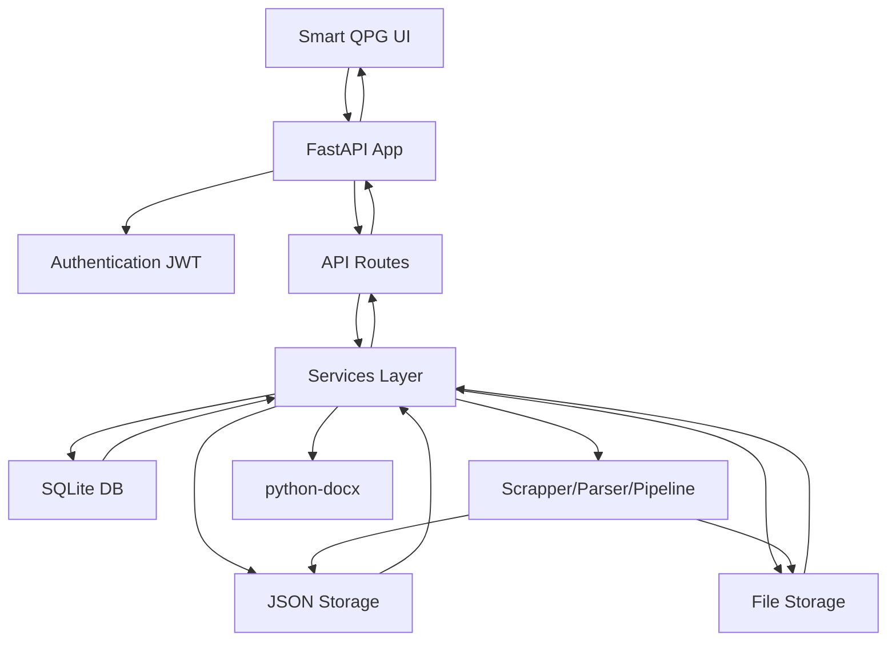

# SMART QPG — BACKEND & FRONTEND INTEGRATION DOCUMENTATION

This document describes the actual implementation as found in the codebase. All details are derived from source inspection — no values were invented.

---

## 1. BACKEND ARCHITECTURE

### 1.1 Framework & Entry Point
- **Framework**: FastAPI (see `pyproject.toml` dependencies; `fastapi>=0.115`, `uvicorn[standard]>=0.30`)
- **Application entry**: `src/masterdeorca/app.py` creates `app = FastAPI(title="MasterDeOrca API", version="1.0.0", description="Admin API for PDF question-bank processing and DOCX reconstruction.", lifespan=lifespan)` and registers CORS middleware.
- **Lifespan/startup**: `@asynccontextmanager async def lifespan(_app: FastAPI)` calls `_startup()`. `_startup()` (line ~43-49 in `app.py`): validates `JWT_SECRET` (must be >=32 chars and not contain "replace" case-insensitively, else RuntimeError), ensures `STORAGE_ROOT` exists, calls `database.initialize()`, `database.mark_interrupted_jobs()`, and `default_subject()`.
- **Alternative entry**: `src/masterdeorca/__init__.py` has `main()` that runs `uvicorn.run("src.masterdeorca.app:app", host="0.0.0.0", port=API_PORT)`. `pipeline_runner.py` exists as well (batch/runner helper per README).

### 1.2 Project Directory Structure (relevant)
```
src/masterdeorca/
├── __init__.py
├── app.py                # All HTTP routes, request/response models, auth wiring
├── database.py           # SQLite schema + helpers for users/jobs/admins
├── processing_manifest.py # Per-subject PDF processing status manifest
├── security.py           # JWT issuance/verification, require_user/require_admin
├── storage.py            # Subject/PDF path validation and layout helpers
└── services/
    ├── pipeline.py       # Scrapper->Parser orchestration + reconstruction
    ├── question_bank.py  # Persistent JSON question bank per subject
    ├── question_papers.py# Blueprints, generation, drafts, DOCX export
    └── question_priorities.py # Global priorities store (separate JSON)

config/
├── settings.py           # Env loading and resolved paths/flags
├── outputs.py            # Stage output dir helpers, pdf_stem sanitization
└── parser.py / scrapper.py / reconstruct.py (referenced by services)

functions/                # Functional modules (Scrapper/Parser/Reconstructor logic)
```

### 1.3 Service Modules & Responsibilities
- **`app.py`**: FastAPI app, route handlers, Pydantic request models (LoginRequest, SubjectRequest, ProcessRequest, TeacherCreate, QuestionCreate, TopicCreate, QuestionPriorityUpdate, QuestionPaperGenerate, DraftDocxExport), exception handler for validation on paper endpoints, background job tracking (`_active_jobs`), wiring to services.
- **`database.py`**: SQLite at `DATABASE_PATH` (see settings). Creates tables on `initialize()`: `users`, `topics`, `questions`, `papers`, `pdf_reviews`, `admins`, `jobs`. Seeds/updates admin from env on init. `verify_user()` checks `users` with status in {`active`,`approved`} and verifies password via `pwdlib.PasswordHash`. `save_job/get_job/latest_job` manage jobs table.
- **`security.py`**: Issues HS256 JWT via `PyJWT` with `sub` = email, `iat`, `exp = now + JWT_TTL_MINUTES`. `require_user` uses `HTTPBearer(auto_error=False)`, decodes token, checks `users.status` in {`active`,`approved`} (looks up in DB). `require_admin` requires role `admin`.
- **`storage.py`**: Validates subject names with regex `^[A-Za-z0-9][A-Za-z0-9 _-]{0,79}$` (no `.`, `..`), PDF filenames must be plain `.pdf` (no paths). Builds `subject_layout()` returning paths for `source`, `scrapper`/`parser`/`reconstruct` under `output/`, plus `manifests`, `logs`, `metadata`. `ensure_subject()` creates subdirs. `list_subject_names()` returns dirs under `STORAGE_ROOT` that are dirs, not symlinks, match subject regex, and have `source/` dir. `default_subject()` calls `ensure_subject(DEFAULT_SUBJECT)`.
- **`processing_manifest.py`**: Per-subject manifest at `{subject}/manifests/processing_status.json` with entries per PDF (id via UUID5, relative paths like `source/...`, `output/Parser/.../questions_parsed.json`, etc.). `sync_subject()` syncs source PDFs and updates from jobs. `update_pdf/remove_pdf` maintain manifest.
- **`services/pipeline.py`**: Orchestrates Scrapper->Parser in isolated temp dirs, rewrites paths, replaces stage outputs atomically, writes result metadata, calls `question_bank.sync_pdf()`, updates job/manifest/logs. `reconstruct_pdf()` calls `DocumentGenerator` from `functions.ReconstructQues.generator`.
- **`services/question_bank.py`**: Subject-scoped persistent JSON at `{subject}/question_bank.json` with file locking (thread + fcntl), atomic writes. Flattens parsed questions (handles sub_questions), generates stable `question_id` via UUID5 namespace `d72e792c-...`. Validates/normalizes marks (`normalize_marks()` returns int/float or None). Handles resources (figures/tables), base64-encodes figures on-demand. `validate_question_changes()`, `create_question()`, `update_question()`. Shares editable fields with drafts.
- **`services/question_papers.py`**: Blueprints stored in `{STORAGE_ROOT}/.masterdeorca/question_paper_blueprints.json` (single default `default-generic` protected). Generates papers by selecting questions from question bank (priority-first with random tie-breaking, or fixed sections), creates DOCX via `python-docx`, persists generated papers/drafts in `{STORAGE_ROOT}/.masterdeorca/generated_papers/` and drafts in `generated_papers/drafts/`. Draft CRUD with validation.
- **`services/question_priorities.py`**: Global priorities JSON at `{STORAGE_ROOT}/.masterdeorca/question_priorities.json` (separate from banks), values 1-3, default 1.

### 1.4 Database Technologies & Storage Locations
- **SQLite**: `DATABASE_PATH` from settings. Defaults to `resolve_path(setting("QUES_DATABASE_PATH", str(STORAGE_ROOT / DEFAULT_SUBJECT / "metadata" / "masterdeorca.sqlite")))`. Tables created in `database.initialize()` (users, topics, questions, papers, pdf_reviews, admins, jobs). Uses `sqlite3.Row`, WAL-like behavior not explicitly configured (just connect). Passwords hashed with `pwdlib.PasswordHash.recommended()` (Argon2).
- **File storage (JSON)**: Question banks per subject (`{subject}/question_bank.json`), blueprints (`.masterdeorca/question_paper_blueprints.json`), priorities (`.masterdeorca/question_priorities.json`), generated papers/drafts (`.masterdeorca/generated_papers/`), processing manifests per subject (`{subject}/manifests/processing_status.json`).
- **Subject storage layout** (under `STORAGE_ROOT/{subject}/`): `source/` (uploaded PDFs), `output/Scrapper/`, `output/Parser/`, `output/Reconstruct/`, `manifests/`, `logs/`, `metadata/`. Created by `ensure_subject()`.

### 1.5 Authentication Architecture
- **JWT-based (bearer)**: `security.issue_token(email)` signs HS256 with secret from `JWT_SECRET` (validated at startup), TTL from `JWT_TTL_MINUTES` (default 480). Token payload has `sub`, `iat`, `exp`.
- **Dependencies**: `require_user` requires valid token, looks up user in DB by email (`sub`), requires status in {`active`,`approved`} else 401. `require_admin` requires role `admin` else 403. `Admin = Annotated[str, Depends(require_admin)]`, some endpoints use `require_user` directly.
- **Login**: `POST /auth/login` takes `LoginRequest` (email, password). Calls `database.verify_user(email, password)`. On success returns `{"access_token": issue_token(...), "token_type": "bearer"}`. On failure 401 "Invalid email or password".
- **No refresh tokens** implemented (see security code - only issue_token).

### 1.6 Middleware
- **CORS**: `app.add_middleware(CORSMiddleware, allow_origins=CORS_ORIGINS, allow_methods=["GET", "POST", "PUT", "PATCH", "DELETE", "OPTIONS"], allow_headers=["Authorization", "Content-Type"])`. Origins from env `QUES_CORS_ORIGINS` (comma-separated, defaults to `http://localhost:3000,http://localhost:5173`).
- **Validation handler**: Custom `request_validation_exception_handler` override for paths `"/api/question-papers/generate"`, `"/api/question-papers/drafts"`, `"/api/question-papers/drafts/generate"` returns structured `{"detail": "...", "errors": [{"field": ..., "message": ...}]}` with 422; otherwise falls back to default FastAPI handler.

### 1.7 Background Tasks & Processing Pipelines
- **BackgroundTasks**: `POST /subjects/{subject}/pdfs/{filename}/process` uses FastAPI `BackgroundTasks` and adds `_run_job(job, key)`. `_run_job` calls `process_pdf_job(job)` then discards key from `_active_jobs` (thread-safe set with lock).
- **Active job tracking**: In-memory `_active_jobs: set[tuple[str,str]]` prevents duplicate processing; also DB `jobs` table tracks state.
- **Pipeline** (`services/pipeline.process_pdf_job`): Acquires global `_pipeline_lock`. Creates isolated temp work dir. Runs Scrapper (`functions.QuesScrapper.ScrapePipeLIne.processPDF.process_pdf`), appends records, checks manifest/rows. Sets parser config globals temporarily, runs Parser (`functions.QuesParser.ParsePipeLIne.question_bank.run`), validates parsed JSON has `questions` list. Publishes by moving staged outputs to final locations atomically (with backups/rollback on error), rewrites paths, updates job/manifest/logs, calls `question_bank.sync_pdf()`, sets final status/result.
- **OCR check**: Before queueing, if PDF needs OCR (any page has <20 chars text), calls `ensure_cuda()` and returns 503 if GPU OCR unavailable.
- **Job interruption**: `database.mark_interrupted_jobs()` marks queued/running jobs as failed with message about restart.

### 1.8 File Storage & Attachment Handling
- **Uploads**: Multipart with field `files` (list). Validates filename via `validate_pdf_filename()`, checks PDF header starts with `%PDF-`, enforces `MAX_UPLOAD_BYTES` (default 50MB from `QUES_MAX_UPLOAD_MB`), prevents overwrite (409 if exists), uses hard link from temp to destination when possible.
- **Question bank attachments**: Figures/tables stored as references in question records (paths/assets/tables). `question_bank.get_question_resource()` resolves figure by reading file bytes and base64-encoding; table returns structured JSON. Paths must stay inside subject directory (validated). Listing only returns metadata/flags if retrievable.
- **Generated files**: DOCX for papers/drafts in `.masterdeorca/generated_papers/`, draft JSONs in `generated_papers/drafts/`.

### 1.9 External Integrations
- **LLM providers** (via LangChain): google-genai, mistralai, groq, nvidia-ai-endpoints, cerebras, openai (see pyproject). Used by Scrapper/Parser (referenced in imports in pipeline). API keys from env (GEMINI_API_KEY, GROQ_API_KEY, MISTRAL_API_KEY, NVIDIA_API_KEY, CEREBRAS_API_KEY).
- **OCR**: PaddleOCR/PaddlePaddle GPU optional extra for scanned PDFs (checked via `functions.QuesScrapper.ScrapethePDF.gpu_runtime.ensure_cuda/runtime_report`).

### 1.10 Request Flow
1. HTTP request arrives at FastAPI app (with CORS middleware)
2. Dependency resolution: auth via `require_user`/`require_admin` (validates JWT, checks user status/role in DB)
3. Route handler validates request (Pydantic models where used; some take raw dict), does path/filename validation via storage helpers
4. Handler calls service layer (question_bank/question_papers/pipeline/database/storage/processing_manifest)
5. Services read/write files (with locking/atomic writes) or SQLite via `database.connect()`
6. Response returned as JSON or FileResponse (for PDFs/DOCX)

---

## 2. API CONFIGURATION

### 2.1 Base URL
- **Local default**: `http://localhost:8000` (per README and for_ui_developers.md)
- **Docs**: `/docs` (OpenAPI)

### 2.2 Development & Production Configuration
Settings loaded from project-root `.env` via `config/settings.py`:
- `PROJECT_ROOT = Path(__file__).resolve().parents[1]` (parent of config dir)
- `load_dotenv(PROJECT_ROOT / ".env", override=False)`

Key settings (defaults from code):
- `STORAGE_ROOT = resolve_path(setting("QUES_STORAGE_ROOT", "../CS_MAIN/SUBJECTS"))`
- `DEFAULT_SUBJECT = setting("QUES_DEFAULT_SUBJECT", "OperatingSys")`
- `MAX_UPLOAD_BYTES = int(setting("QUES_MAX_UPLOAD_MB", "50")) * 1024 * 1024`
- `API_PORT = int(setting("QUES_PORT", "8000"))`
- `DATABASE_PATH = resolve_path(setting("QUES_DATABASE_PATH", str(STORAGE_ROOT / DEFAULT_SUBJECT / "metadata" / "masterdeorca.sqlite")))`
- `JWT_SECRET = setting("QUES_JWT_SECRET", "")` (must be >=32 chars, no "replace" substring)
- `JWT_TTL_MINUTES = int(setting("QUES_JWT_TTL_MINUTES", "480"))`
- `ADMIN_EMAIL = setting("QUES_ADMIN_EMAIL", "admin@example.com").lower()`
- `ADMIN_PASSWORD = setting("QUES_ADMIN_PASSWORD", "admin123")`
- `CORS_ORIGINS = [origin.strip() for origin in setting("QUES_CORS_ORIGINS", "http://localhost:3000,http://localhost:5173").split(",") if origin.strip()]`
- `SCRAPPER_ROOT/PARSER_ROOT/RECONSTRUCT_ROOT` set from env with defaults under STORAGE_ROOT/DEFAULT_SUBJECT/output/*

### 2.3 API Prefixes
- Many routes under `/api/*` (e.g. `/api/question-bank`, `/api/question-papers/*`, `/api/question-paper/*`)
- Some routes without `/api` prefix for compatibility: `/blueprints`, `/blueprints/{id}`, `/auth/login`, `/subjects`, `/teachers`, `/questions`, `/papers`, `/health` (public)
- Both `/api/question-paper/blueprints...` and `/blueprints...` are registered

### 2.4 Authentication Requirements
- **Public**: `GET /health`
- **Authenticated (any active/approved user)**: Most `/api/*` routes, `/auth/me`, `/papers`, subject question bank reads/writes (require_user), topic listing for user, etc.
- **Admin only**: `/subjects` (GET/POST/PATCH/DELETE), `/subjects/{subject}/pdfs` (GET/POST), processing start, job status (admin dependency in handlers), teachers CRUD, questions CRUD/import, topics create/update/delete, PDF review/update/delete. Many admin routes use `_: Admin = Depends(require_admin)`.

### 2.5 Required Headers
- **JSON requests**: `Content-Type: application/json` (when sending body)
- **Authenticated requests**: `Authorization: Bearer <access_token>`
- **File uploads**: `Content-Type: multipart/form-data` (browser sets boundary); auth header required

### 2.6 Content Types
- JSON for most API calls
- Multipart form data for uploads (`files` field)
- File responses: `application/vnd.openxmlformats-officedocument.wordprocessingml.document` for DOCX downloads, PDF uploads validated by header

### 2.7 CORS Configuration
Configured in app with allowed origins from env, methods GET/POST/PUT/PATCH/DELETE/OPTIONS, headers Authorization and Content-Type.

### 2.8 Request Timeout Expectations
Not explicitly configured in codebase (no timeout middleware visible). Defaults are framework/environment dependent.

### 2.9 Error-Handling Conventions
- HTTPException with status codes and `detail` (string or dict). Some routes return JSONResponse directly (custom validation for paper endpoints).
- Validation errors: FastAPI/Pydantic by default except custom handler for specific paper routes returning structured field errors.
- Business errors return appropriate codes (409 for conflicts, 422 for validation/business constraints, 404 for missing, 401/403 for auth).

---

## 3. COMPLETE API ENDPOINT INVENTORY

All routes from `src/masterdeorca/app.py`. Auth: Admin = require_admin, user = require_user.

### System
| Method | Endpoint | Purpose | Auth | Permissions | Path Params | Query Params | Headers | Request Body | Response | Status Codes | Backend Service/Function | Side Effects |
|--------|----------|---------|------|-------------|-------------|--------------|---------|--------------|----------|--------------|---------------------------|--------------|
| GET | `/health` | Health check with OCR status | Public | - | - | - | - | - | `{"status": "ok"|"degraded", "ocr": {...}}` (from `runtime_report()`) | 200 | `runtime_report()` from gpu_runtime | None | 

### Authentication
| Method | Endpoint | Purpose | Auth | Permissions | Path Params | Query Params | Headers | Request Body | Response | Status Codes | Backend Service/Function | Side Effects |
|--------|----------|---------|------|-------------|-------------|--------------|---------|--------------|----------|--------------|---------------------------|--------------|
| POST | `/auth/login` | Login | Public | - | - | - | Content-Type: application/json | `LoginRequest` {email, password} | `{"access_token": str, "token_type": "bearer"}` | 200, 401 | `database.verify_user()`, `security.issue_token()` | None |
| GET | `/auth/me` | Current user | User | Active/approved | - | - | Authorization: Bearer | - | User row dict from DB (id,email,name,role,status) | 200, 401 | `database.connect()`, `_user_row()` | None |

### Subjects
| Method | Endpoint | Purpose | Auth | Permissions | Path Params | Query Params | Headers | Request Body | Response | Status Codes | Backend Service/Function | Side Effects |
|--------|----------|---------|------|-------------|-------------|--------------|---------|--------------|----------|--------------|---------------------------|--------------|
| GET | `/subjects` | List subjects | Admin | admin | - | - | Authorization: Bearer | - | `{"subjects": [str,...]}` | 200, 401, 403 | `storage.list_subject_names()` | None |
| POST | `/subjects` | Create subject | Admin | admin | - | - | Authorization: Bearer, Content-Type: application/json | `SubjectRequest` {name} | `{"name": str, "created": true, "directories": {...}}` (excluding base) | 201, 401, 403, 409, 422 | `storage.validate_subject_name()`, `storage.subject_layout()`, `storage.ensure_subject()` | Creates directories on disk |
| PATCH | `/subjects/{subject}` | Rename subject | Admin | admin | subject (str) | - | Authorization: Bearer, Content-Type: application/json | `SubjectRequest` {name} | `{"name": str, "renamed": bool}` | 200, 401, 403, 404, 409, 422 | `storage.validate_subject_name()`, `storage.subject_layout()`, DB updates | Renames directory, updates DB tables (topics, questions, papers, jobs, pdf_reviews) |
| DELETE | `/subjects/{subject}` | Delete subject | Admin | admin | subject (str) | - | Authorization: Bearer | - | 204 No Content | 204, 401, 403, 404, 409 | `storage.validate_subject_name()`, checks active jobs, `shutil.rmtree()`, DB deletes | Deletes entire subject dir and related DB rows |

### PDFs
| Method | Endpoint | Purpose | Auth | Permissions | Path Params | Query Params | Headers | Request Body | Response | Status Codes | Backend Service/Function | Side Effects |
|--------|----------|---------|------|-------------|-------------|--------------|---------|--------------|----------|--------------|---------------------------|--------------|
| GET | `/subjects/{subject}/pdfs` | List PDFs for subject | Admin | admin | subject (str) | - | Authorization: Bearer | - | `{"subject": str, "pdfs": [{"filename", "size_bytes", "status", "job_id", "result_available", "review_status"}, ...]}` | 200, 401, 403, 404 | `storage.subject_layout()`, `storage.ensure_subject()`, `database`, `processing_manifest.sync_subject()` | None |
| POST | `/subjects/{subject}/pdfs` | Upload PDFs | Admin | admin | subject (str) | - | Authorization: Bearer, multipart/form-data | files (list of UploadFile) | `{"subject": str, "uploaded": [{"filename", "size_bytes", "path"}, ...]}` | 201, 400, 401, 403, 404, 409, 413, 415, 422 | `storage`, validation, file writing | Saves files to disk, calls `processing_manifest.update_pdf()` |
| PATCH | `/subjects/{subject}/pdfs/{filename}` | Update PDF review status | Admin | admin | subject, filename | - | Authorization: Bearer, Content-Type: application/json | `{"review_status": "unreviewed"|"approved"|"disapproved"}` | `{"filename", "review_status", "size_bytes", "status", "result_available"}` | 200, 401, 403, 404, 422 | `storage.validate_pdf_filename()`, DB upsert pdf_reviews, checks parsed file/job | Updates DB |
| DELETE | `/subjects/{subject}/pdfs/{filename}` | Delete PDF | Admin | admin | subject, filename | - | Authorization: Bearer | - | 204 No Content | 204, 401, 403, 404, 409 | `storage.validate_pdf_filename()`, checks active jobs, removes stage dirs, deletes file, DB cleanup, `processing_manifest.remove_pdf()` | Deletes files/dirs and DB rows |

### Processing
| Method | Endpoint | Purpose | Auth | Permissions | Path Params | Query Params | Headers | Request Body | Response | Status Codes | Backend Service/Function | Side Effects |
|--------|----------|---------|------|-------------|-------------|--------------|---------|--------------|----------|--------------|---------------------------|--------------|
| POST | `/subjects/{subject}/pdfs/{filename}/process` | Start processing (Scrapper->Parser) | Admin | admin | subject, filename | - | Authorization: Bearer, Content-Type: application/json | `ProcessRequest` {force: bool} (default true) | `{"job_id", "status": "queued", "subject", "filename"}` | 202, 401, 403, 404, 409, 503 | `storage.validate_pdf_filename()`, `pdf_path()`, `extract_pdf_text()`, `ensure_cuda()` for OCR, `database.latest_job()`, creates job, `BackgroundTasks.add_task(_run_job)` | Creates job in DB, adds to `_active_jobs`, starts background task |
| GET | `/jobs/{job_id}` | Get job status | Admin | admin | job_id (str) | - | Authorization: Bearer | - | `_job_payload(job)` = {job_id, subject, filename, status, stage, started_at, updated_at, error, result} | 200, 401, 403, 404 | `database.get_job()` | None |
| GET | `/subjects/{subject}/pdfs/{filename}/status` | Get PDF status | Admin | admin | subject, filename | - | Authorization: Bearer | - | Job payload or `{"subject","filename","status":"not_processed"}` | 200, 401, 403, 404 | `pdf_path()`, `database.latest_job()` | None |
| GET | `/subjects/{subject}/pdfs/{filename}/result` | Get parsed result metadata | Admin | admin | subject, filename | include_questions: bool=false | Authorization: Bearer | - | `{"subject","filename","parsed_json", "question_count", "metadata", "questions"?}` | 200, 401, 403, 404, 409 | `pdf_path()`, `ensure_subject()`, reads parsed JSON, checks job status | None |

### Reconstruction
| Method | Endpoint | Purpose | Auth | Permissions | Path Params | Query Params | Headers | Request Body | Response | Status Codes | Backend Service/Function | Side Effects |
|--------|----------|---------|------|-------------|-------------|--------------|---------|--------------|----------|--------------|---------------------------|--------------|
| POST | `/subjects/{subject}/pdfs/{filename}/reconstruct` | Generate DOCX from parsed | Admin | admin | subject, filename | - | Authorization: Bearer | - | `{"docx_path", "question_count", "subquestion_count", "figures_inserted", "warnings", "missing_assets"}` | 200, 401, 403, 404, 409, 422 | `database.latest_job()`, `pipeline.reconstruct_pdf()` calls `DocumentGenerator` | Creates DOCX on disk |
| GET | `/subjects/{subject}/pdfs/{filename}/reconstruction` | Download reconstructed DOCX | Admin | admin | subject, filename | - | Authorization: Bearer | - | FileResponse (DOCX) | 200, 401, 403, 404 | `pdf_path()`, looks for file in reconstruct output dir | None |

### Question Bank (Persistent JSON)
| Method | Endpoint | Purpose | Auth | Permissions | Path Params | Query Params | Headers | Request Body | Response | Status Codes | Backend Service/Function | Side Effects |
|--------|----------|---------|------|-------------|-------------|--------------|---------|--------------|----------|--------------|---------------------------|--------------|
| GET | `/api/question-bank` | List questions in subject bank | User | active/approved | - | subject_id (required), marks (float>0), page (>=1 default 1), page_size (1-200 default 25) | Authorization: Bearer | - | `{"items": [...], "pagination": {...}, "filters": {...}, "available_marks": [...]}` | 200, 401, 404, 422 | `storage.validate_subject_name()`, `question_bank_service.read_subject()`, computes available_marks, filters/paginates, adds priorities/resources/has_figures/has_tables | None |
| GET | `/api/question-bank/{question_id}` | Get question detail | User | active/approved | question_id (str) | subject_id (required) | Authorization: Bearer | - | Question detail with resources/priorities/flags | 200, 401, 404, 422 | `question_bank_service.get_question_detail()` | None |
| GET | `/api/question-bank/{question_id}/resources/{content_type}/{resource_id}` | Get figure/table resource | User | active/approved | question_id, content_type, resource_id | subject_id (required) | Authorization: Bearer | - | Figure: `{"type":"figure", "metadata": {...}, "content_base64": "..."}`; Table: `{"type":"table", "metadata": {...}, "content": {"headers": [...], "rows": [...]}}` | 200, 401, 404, 422 | `question_bank_service.get_question_resource()` | None |
| POST | `/api/question-bank` | Create manual question | User | active/approved | - | - | Authorization: Bearer, Content-Type: application/json | dict with subject_id, text/original_text/cleaned_text, marks, optional fields (priority, idempotency_key, etc.) | Saved question record | 201, 401, 404, 409, 422 | `question_bank_service.create_question()` | Writes to question_bank.json, sets priority if provided |
| PATCH | `/api/question-bank/{question_id}` | Update question | User | active/approved | question_id | subject_id (optional in query or body) | Authorization: Bearer, Content-Type: application/json | dict with fields to change | Updated question record | 200, 401, 404, 422 | `question_bank_service.update_question()` | Updates question_bank.json, sets priority if provided |

### Question Priorities
| Method | Endpoint | Purpose | Auth | Permissions | Path Params | Query Params | Headers | Request Body | Response | Status Codes | Backend Service/Function | Side Effects |
|--------|----------|---------|------|-------------|-------------|--------------|---------|--------------|----------|--------------|---------------------------|--------------|
| GET | `/api/question-priorities` | Get priorities | User | active/approved | - | subject_id (optional) | Authorization: Bearer | - | `{"subject_id": ..., "default_priority": 1, "priorities": {...}}` | 200, 401, 404 | `question_priorities_service.get_priorities()`, validates questions exist via `_priority_question_ids()` | None |
| PUT | `/api/question-priorities` | Set priority | User | active/approved | - | - | Authorization: Bearer, Content-Type: application/json | `QuestionPriorityUpdate` {question_id, priority (1-3), subject_id?} | `{"question_id", "subject_id", "priority", "updated": true}` | 200, 401, 404, 422 | `_check_priority_question()`, `question_priorities_service.set_priority()` | Writes priorities JSON |
| DELETE | `/api/question-priorities/{question_id}` | Reset priority to 1 | User | active/approved | question_id | subject_id (optional) | Authorization: Bearer | - | `{"question_id", "subject_id", "priority": 1, "reset": bool}` | 200, 401, 404 | `_check_priority_question()`, `question_priorities_service.delete_priority()` | Writes priorities JSON |

### Blueprints
| Method | Endpoint | Purpose | Auth | Permissions | Path Params | Query Params | Headers | Request Body | Response | Status Codes | Backend Service/Function | Side Effects |
|--------|----------|---------|------|-------------|-------------|--------------|---------|--------------|----------|--------------|---------------------------|--------------|
| GET | `/api/question-paper/blueprints` or `/blueprints` | List blueprints | User | active/approved | - | - | Authorization: Bearer | - | `{"items": [...], "quick_mark_presets": [15,25,50,60,70,80,100]}` | 200, 401 | `question_papers_service.list_blueprints()` | None |
| GET | `/api/question-paper/blueprints/{blueprint_id}` or `/blueprints/{blueprint_id}` | Get blueprint | User | active/approved | blueprint_id | - | Authorization: Bearer | - | Blueprint object | 200, 401, 404 | `question_papers_service.get_blueprint()` | None |
| POST | `/api/question-paper/blueprints` or `/blueprints` | Create blueprint | User | active/approved | - | - | Authorization: Bearer, Content-Type: application/json | dict (blueprint) | Blueprint object (201) | 201, 401, 409, 422 | `question_papers_service.save_blueprint(create=True)` | Writes blueprints JSON |
| PUT/PATCH | `/api/question-paper/blueprints/{blueprint_id}` or `/blueprints/{blueprint_id}` | Update blueprint | User | active/approved | blueprint_id | - | Authorization: Bearer, Content-Type: application/json | dict (fields) | Blueprint object | 200, 401, 404, 422 | `question_papers_service.save_blueprint()` (merges for PATCH) | Writes blueprints JSON |
| POST | `/api/question-paper/blueprints/{blueprint_id}/duplicate` or `/blueprints/{blueprint_id}/duplicate` | Duplicate blueprint | User | active/approved | blueprint_id | - | Authorization: Bearer, Content-Type: application/json (optional) | dict or null {blueprint_id?, name?} | Blueprint object (201) | 201, 401, 404, 409, 422 | `question_papers_service.save_blueprint(create=True)` | Writes blueprints JSON |
| DELETE | `/api/question-paper/blueprints/{blueprint_id}` or `/blueprints/{blueprint_id}` | Delete blueprint | User | active/approved | blueprint_id | - | Authorization: Bearer | - | `{"blueprint_id", "deleted": true}` | 200, 401, 404, 409 | `question_papers_service.delete_blueprint()` | Writes blueprints JSON |

### Question Papers (Generate/Download)
| Method | Endpoint | Purpose | Auth | Permissions | Path Params | Query Params | Headers | Request Body | Response | Status Codes | Backend Service/Function | Side Effects |
|--------|----------|---------|------|-------------|-------------|--------------|---------|--------------|----------|--------------|---------------------------|--------------|
| POST | `/api/question-papers/generate` | Generate paper directly | User | active/approved | - | - | Authorization: Bearer, Content-Type: application/json | `QuestionPaperGenerate` | Generated paper object with sections/questions/docx_url | 200, 401, 404, 422 | `question_papers_service.select_blueprint()`, `question_papers_service.generate_paper()` | Creates DOCX and JSON in generated_papers/ |
| GET | `/api/question-papers/{paper_id}/docx` | Download generated paper DOCX | User | active/approved | paper_id | - | Authorization: Bearer | - | FileResponse (DOCX) | 200, 401, 404 | `question_papers_service.paper_docx_path()` | None |

### Question Paper Drafts
| Method | Endpoint | Purpose | Auth | Permissions | Path Params | Query Params | Headers | Request Body | Response | Status Codes | Backend Service/Function | Side Effects |
|--------|----------|---------|------|-------------|-------------|--------------|---------|--------------|----------|--------------|---------------------------|--------------|
| POST | `/api/question-papers/drafts` or `/api/question-papers/drafts/generate` | Create draft from generation | User | active/approved | - | - | Authorization: Bearer, Content-Type: application/json | `QuestionPaperGenerate` | Draft object | 201, 401, 404, 422 | `question_papers_service.create_draft()` (calls generate_paper then builds draft) | Creates draft JSON in generated_papers/drafts/ |
| GET | `/api/question-papers/drafts/{draft_id}` | Get draft | User | active/approved | draft_id | - | Authorization: Bearer | - | Draft object | 200, 401, 404 | `question_papers_service.get_draft()` | None |
| PATCH | `/api/question-papers/drafts/{draft_id}` | Update draft metadata/sections | User | active/approved | draft_id | - | Authorization: Bearer, Content-Type: application/json | dict with allowed fields | Updated draft | 200, 401, 404, 422 | `question_papers_service.update_draft()` | Updates draft JSON |
| POST | `/api/question-papers/drafts/{draft_id}/questions` | Add question to draft | User | active/approved | draft_id | - | Authorization: Bearer, Content-Type: application/json | `{"question_id": str, "section": str}` | Updated draft | 200, 401, 404, 422 | `question_papers_service.add_draft_question()` | Updates draft JSON |
| PATCH | `/api/question-papers/drafts/{draft_id}/questions/{question_id}` | Edit draft question | User | active/approved | draft_id, question_id | - | Authorization: Bearer, Content-Type: application/json | `{"text"?, "marks"?, "section"?}` | Updated draft | 200, 401, 404, 422 | `question_papers_service.update_draft_question()` | Updates draft JSON |
| DELETE | `/api/question-papers/drafts/{draft_id}/questions/{question_id}` | Remove question from draft | User | active/approved | draft_id, question_id | - | Authorization: Bearer | - | Updated draft | 200, 401, 404 | `question_papers_service.remove_draft_question()` | Updates draft JSON |
| PUT | `/api/question-papers/drafts/{draft_id}/question-order` | Reorder questions | User | active/approved | draft_id | - | Authorization: Bearer, Content-Type: application/json | `{"question_ids": [str,...]}` | Updated draft | 200, 401, 404, 422 | `question_papers_service.reorder_draft_questions()` | Updates draft JSON |
| POST | `/api/question-papers/drafts/{draft_id}/docx` | Export draft as DOCX | User | active/approved | draft_id | - | Authorization: Bearer, Content-Type: application/json (optional) | `DraftDocxExport` {include_processing_accuracy_notice?: bool} | FileResponse (DOCX) | 200, 401, 404, 422 | `question_papers_service.export_draft_docx()` | Creates/returns DOCX file |

### Teachers
| Method | Endpoint | Purpose | Auth | Permissions | Path Params | Query Params | Headers | Request Body | Response | Status Codes | Backend Service/Function | Side Effects |
|--------|----------|---------|------|-------------|-------------|--------------|---------|--------------|----------|--------------|---------------------------|--------------|
| GET | `/teachers` | List teachers | Admin | admin | - | status?, search?, page (1), page_size (50,1-200) | Authorization: Bearer | - | `{"teachers": [...], "total": int}` | 200, 401, 403 | DB query | None |
| POST | `/teachers` | Create teacher | Admin | admin | - | - | Authorization: Bearer, Content-Type: application/json | `TeacherCreate` {name,email,department,password?,status?} | Teacher object | 201, 401, 403, 409, 422 | DB insert, hashes password if not provided (generates random) | Creates user row |
| PATCH | `/teachers/{teacher_id}` | Update teacher | Admin | admin | teacher_id (int) | - | Authorization: Bearer, Content-Type: application/json | dict with allowed fields | Teacher object | 200, 401, 403, 404, 409, 422 | DB update | Updates user row |
| DELETE | `/teachers/{teacher_id}` | Delete teacher | Admin | admin | teacher_id (int) | - | Authorization: Bearer | - | 204 No Content | 204, 401, 403, 404 | DB update papers.created_by to NULL, deletes user | Updates/deletes rows |

### Questions (DB-backed)
| Method | Endpoint | Purpose | Auth | Permissions | Path Params | Query Params | Headers | Request Body | Response | Status Codes | Backend Service/Function | Side Effects |
|--------|----------|---------|------|-------------|-------------|--------------|---------|--------------|----------|--------------|---------------------------|--------------|
| GET | `/questions` | List questions | User | active/approved | - | subject?, status?, difficulty?, search?, page (1), page_size (50,1-200) | Authorization: Bearer | - | `{"questions": [...], "total": int}` | 200, 401 | DB query with joins | None |
| POST | `/questions` | Create question | Admin | admin | - | - | Authorization: Bearer, Content-Type: application/json | `QuestionCreate` | Question object | 201, 401, 403, 404, 422 | DB insert, validates | Creates question row |
| PATCH | `/questions/{question_id}` | Update question | Admin | admin | question_id (int) | - | Authorization: Bearer, Content-Type: application/json | dict | Question object | 200, 401, 403, 404, 422 | DB update, validates | Updates question row |
| DELETE | `/questions/{question_id}` | Delete question | Admin | admin | question_id (int) | - | Authorization: Bearer | - | 204 No Content | 204, 401, 403, 404 | DB delete | Deletes question row |

### Topics
| Method | Endpoint | Purpose | Auth | Permissions | Path Params | Query Params | Headers | Request Body | Response | Status Codes | Backend Service/Function | Side Effects |
|--------|----------|---------|------|-------------|-------------|--------------|---------|--------------|----------|--------------|---------------------------|--------------|
| GET | `/subjects/{subject}/topics` | List topics | User | active/approved | subject | - | Authorization: Bearer | - | `{"subject": str, "topics": [...]}` | 200, 401, 404 | DB query with count | None |
| POST | `/subjects/{subject}/topics` | Create topic | Admin | admin | subject | - | Authorization: Bearer, Content-Type: application/json | `TopicCreate` | Topic object | 201, 401, 403, 404, 409, 422 | DB insert | Creates topic row |
| PATCH | `/topics/{topic_id}` | Update topic | Admin | admin | topic_id (int) | - | Authorization: Bearer, Content-Type: application/json | dict | Topic object | 200, 401, 403, 404, 409, 422 | DB update | Updates topic row |
| DELETE | `/topics/{topic_id}` | Delete topic | Admin | admin | topic_id (int) | - | Authorization: Bearer | - | 204 No Content | 204, 401, 403, 404 | DB delete | Deletes topic row |

### Import & Papers (DB)
| Method | Endpoint | Purpose | Auth | Permissions | Path Params | Query Params | Headers | Request Body | Response | Status Codes | Backend Service/Function | Side Effects |
|--------|----------|---------|------|-------------|-------------|--------------|---------|--------------|----------|--------------|---------------------------|--------------|
| POST | `/subjects/{subject}/pdfs/{filename}/questions/import` | Import parsed questions to DB | Admin | admin | subject, filename | - | Authorization: Bearer, Content-Type: application/json (optional) | `{"overwrite"?: bool}` | `{"imported": int, "skipped_duplicates": int, "questions": [...]}` | 201, 401, 403, 404, 409 | Reads parsed JSON, walks questions/sub_questions, inserts into DB questions table | Inserts into DB |
| GET | `/papers` | List papers | User | active/approved | - | subject?, page, page_size, created_by? | Authorization: Bearer | - | `{"papers": [...], "total": int}` | 200, 401 | DB query with joins/filters | None |
| GET | `/subjects/{subject}/weightage` | Topic weightage analytics | User | active/approved | subject | - | Authorization: Bearer | - | `{"subject", "papers_analyzed", "topics": [...]}` | 200, 401, 404 | DB queries | None |

---

## 4. REQUEST AND RESPONSE SCHEMAS

### 4.1 Request Schemas (Pydantic/models)
From `app.py`:
- `LoginRequest`: `{email: str(min_length=3,max_length=254), password: str(min_length=1,max_length=256)}`
- `SubjectRequest`: `{name: str(min_length=1,max_length=80)}`
- `ProcessRequest`: `{force: bool = True}`
- `TeacherCreate`: `{name: str(min_length=1,max_length=120), email: str(min_length=3,max_length=254), department: str(max_length=64), password: str|None = None(min_length=8,max_length=256), status: str = "pending"}`
- `QuestionCreate`: `{subject: str(min_length=1,max_length=80), topic_id: int|None=None, text: str(min_length=1,max_length=2000), difficulty: str, type: str, marks: int(ge=1,le=100)}`
- `TopicCreate`: `{name: str(min_length=1,max_length=120), unit: int|None=Field(ge=1), description: str|None=None}`
- `QuestionPriorityUpdate`: `{question_id: str(min_length=1,max_length=200), priority: StrictInt(ge=1,le=3), subject_id: str|None=Field(min_length=1,max_length=80)}`
- `QuestionPaperGenerate`: `{title: str(min_length=1,max_length=200, validation_alias=AliasChoices("title","paper_title")), subject: str(min_length=1,max_length=80), exam_type: str(min_length=1,max_length=100), total_marks: StrictInt(ge=1,le=1000), duration: str(min_length=1,max_length=100), blueprint_id: str|None(max_length=100), seed: StrictInt|None=None, university_name/college_name/department_name/academic_year/semester/subject_name/subject_code/examination_date: str|None(max_length=...) , include_processing_accuracy_notice: bool=False}` with validators stripping whitespace and rejecting empty strings.
- `DraftDocxExport`: `{include_processing_accuracy_notice: bool|None=None}`

### 4.2 Response Schemas (actual)
- **Auth**: `{"access_token": "...", "token_type": "bearer"}`
- **Health**: `{"status": "ok"|"degraded", "ocr": {...}}` from `runtime_report()`
- **Subjects**: `{"subjects": [...]}` or `{"name", "created", "directories": {...}}`
- **Question Bank list**: `{"items": [...], "pagination": {"page", "page_size", "total_items", "total_pages"}, "filters": {"subject_id", "marks"}, "available_marks": [...]}`. Items have fields from bank + `priority`, serialized via `serialize_question_for_api()`, `resources`, `has_figures`, `has_tables`.
- **Question Bank detail**: Result of `get_question_detail()` includes question fields, normalized text, `priority`, `resources` (lightweight), `has_figures`, `has_tables`.
- **Resource figure**: `{"question_id", "subject_id", "type": "figure", "metadata": {...}, "content_base64": "..."}`. Metadata includes resource_id, content_type, filename, caption/description, source_pdf, source_page/source_pages.
- **Resource table**: `{"question_id", "subject_id", "type": "table", "metadata": {...}, "content": {"headers": [...], "rows": [...]}}`
- **Priorities**: `{"subject_id", "default_priority": 1, "priorities": {qid: 1-3,...}}` or update responses as shown.
- **Blueprints**: List returns `{"items": [...], "quick_mark_presets": [...]}`. Item has `blueprint_id`, `name`, `description?`, `subject_id?`, `exam_type?`, `auto_select`, `selection_rule`, `instructions`, `sections`, `total_marks?`, `is_default`.
- **Papers generate**: `{"paper_id", "title", "subject", "exam_type", "duration", "requested_total_marks", "total_marks", "blueprint_id", "instructions", "sections": [{"name", "instructions"?, "questions": [...], "question_count", "marks"}], "shortages": [...], "seed"?, ..., "docx_path", "docx_url", ...}`
- **Drafts**: Similar structure with `draft_id`, `created_at`, `status`, sections with questions including `bank_question_id`, `assets`, `tables`, editable fields.
- **Jobs**: `{"job_id", "subject", "filename", "status", "stage", "started_at", "updated_at", "error", "result": {...}|null}`
- **Processing result**: `{"subject","filename","parsed_json","question_count","metadata", "questions"?}`
- **Reconstruct**: `{"docx_path", "question_count", "subquestion_count", "figures_inserted", "warnings", "missing_assets"}`

### 4.3 Distinctions
- **Required/optional/nullable/computed/conditional**: Follow Pydantic and code logic. For example marks can be normalized to int/float or None; resources only included if retrievable; `has_figures/has_tables` true only when resources arrays non-empty and retrievable.
- **Parsed JSON vs legacy SQLite**: The Question Bank system (`/api/question-bank*`) is the persistent JSON bank synced from parsed results (`question_bank.sync_pdf()`). There is also a separate legacy DB system (`/questions`, `/topics`, `/papers`, import from parsed to DB) - clearly different storage/models.

---

## 5. FRONTEND INTEGRATION WORKFLOW

### 5.1 Authentication and current user
1. Call `POST /auth/login` with `{email,password}`. Get `{access_token, token_type}`. Store token securely.
2. Include header `Authorization: Bearer <token>` on all authenticated requests.
3. Get current user via `GET /auth/me`.
4. Handle 401 (invalid/expired/missing) - redirect to login.

### 5.2 Dashboard metrics
Not explicitly a single dashboard endpoint in routes shown. Metrics come from listing subjects/pdfs/jobs/questions. Use available endpoints as needed.

### 5.3 Subject listing and creation
1. `GET /subjects` (admin) to list.
2. `POST /subjects` with `{name}` to create. Names validated by regex.
3. After creation, can upload PDFs to subject.

### 5.4 Subject management
- Rename: `PATCH /subjects/{subject}` with `{name}`
- Delete: `DELETE /subjects/{subject}` (fails if active jobs)
- Manage PDFs/reviews within subject

### 5.5 Question Bank retrieval
1. Get subjects (or know subject). Call `GET /api/question-bank?subject_id={subject}` (required). Optional `marks`, `page`, `page_size`.
2. Display items with flags `has_figures`/`has_tables`. Use `available_marks` for filter options.
3. For details: `GET /api/question-bank/{question_id}?subject_id={subject}`
4. For resources: call resource endpoint when user requests figure/table.

### 5.6 Available marks retrieval
From `GET /api/question-bank` response `available_marks` - computed from all records in subject bank before filtering/pagination, sorted distinct positive numbers.

### 5.7 Question filtering and pagination
Use query params `marks` (exact numeric match after normalization), `page`, `page_size`. Invalid values return 422.

### 5.8 Question creation and editing
- Create: `POST /api/question-bank` with required fields (subject_id, text/original_text/cleaned_text, marks). Can include priority, idempotency_key.
- Edit: `PATCH /api/question-bank/{question_id}?subject_id={subject}` or include in body. Only changed fields sent.

### 5.9 Question priorities
- Get: `GET /api/question-priorities?subject_id={subject}` or all
- Set: `PUT /api/question-priorities` with body `{question_id, priority, subject_id?}`
- Reset: `DELETE /api/question-priorities/{question_id}?subject_id={subject}`

### 5.10 Figures and tables retrieval
Check `has_figures`/`has_tables` and `resources` arrays from listing/detail. Fetch on demand via resource endpoint. Display base64 images or render tables.

### 5.11 Question source metadata
Available in items/detail (source_pdf, source_path, original_question_number, page_number/source_pages, section_name, etc.)

### 5.12 PYQ PDF uploads
`POST /subjects/{subject}/pdfs` with multipart `files` field(s). Returns uploaded list.

### 5.13 PDF processing
`POST /subjects/{subject}/pdfs/{filename}/process` with optional `{force:true}`. Returns 202 with job_id.

### 5.14 Processing status polling or updates
Poll `GET /jobs/{job_id}` or `GET /subjects/{subject}/pdfs/{filename}/status` until status is succeeded/failed.

### 5.15 Parsed question retrieval
`GET /subjects/{subject}/pdfs/{filename}/result` (optionally `?include_questions=true`).

### 5.16 DOCX generation and retrieval
- From parsed: `POST /subjects/{subject}/pdfs/{filename}/reconstruct` then `GET /subjects/{subject}/pdfs/{filename}/reconstruction`
- From drafts/papers: `POST /api/question-papers/drafts/{draft_id}/docx` or `GET /api/question-papers/{paper_id}/docx`

### 5.17 Question paper generation
Can use `POST /api/question-papers/generate` directly or create draft first.

### 5.18 Blueprint listing and management
Use `/blueprints` endpoints as documented.

### 5.19 Section configuration
Done via blueprints or draft editing.

### 5.20 Generated paper management
Papers saved as files; access via docx endpoints.

### 5.21 Teachers and permissions
Admin manages teachers via `/teachers` CRUD.

### 5.22 Profile management
`GET /auth/me` for current user.

### 5.23 Notifications and help
Not implemented as separate endpoints in routes.

### Notes on workflows
- All authenticated requests need Bearer token
- Question Bank is the primary source for paper generation/drafts (from parsed results synced)
- Processing is async with job tracking
- Some features have both `/api/*` and non-`/api` routes for compatibility

---

## 6. QUESTION BANK — DETAILED CONTRACT

### 6.1 Subject selection
Must pass `subject_id` (exact subject directory name). Validated via `validate_subject_name()`. Returns 404 if subject dir doesn't exist. Omitting returns 422.

### 6.2 Available marks retrieval
`available_marks` in list response - distinct positive marks from subject bank before filtering/pagination, sorted ascending. Numeric strings normalized.

### 6.3 Distinct marks calculation
Computed by iterating all records, normalizing marks via `question_bank_service.normalize_marks()`, collecting set of values.

### 6.4 Marks filtering
Query param `marks` (float>0). Exact match against normalized numeric value. Invalid/non-positive returns 422. No matches returns 200 with empty items.

### 6.5 Question retrieval
List with pagination; detail via `GET /api/question-bank/{question_id}?subject_id={subject}`.

### 6.6 Pagination
`page` (>=1 default 1), `page_size` (1-200 default 25). Response includes pagination object.

### 6.7 Priority retrieval
Priorities fetched separately via `/api/question-priorities` or included as `priority` (default 1) in items/detail.

### 6.8 Question identifiers
`question_id` is stable UUID-like string (generated via UUID5 or provided). Used across endpoints.

### 6.9 Source metadata
Includes source_pdf, source_path, original_question_number, source_pages/page_number, section_name, source_id, parsed_question_id.

### 6.10 Figure and table metadata
In resources arrays and flags. `has_figures`/`has_tables` true only if retrievable attachments exist.

### 6.11 Editing and saving questions
Via `PATCH /api/question-bank/{question_id}` - validates changes, preserves ID/subject, updates JSON bank atomically.

### 6.12 Determining figures/tables
Check `has_figures` and `has_tables` booleans; also inspect `resources.figures`/`resources.tables` arrays. Only fetch via resource endpoint if needed.

### 6.13 Parsed JSON vs legacy SQLite
**Parsed JSON Question Bank** (`/api/question-bank*`): persistent JSON per subject synced from processing pipeline via `question_bank.sync_pdf()`. This is the bank used by paper generation/drafts.  
**Legacy SQLite** (`/questions`, import endpoint): separate DB tables - different system, marked as legacy in context.

---

## 7. FILE UPLOAD AND PROCESSING CONTRACT

### 7.1 Accepted file formats
Only PDF files. Validated by filename ending in `.pdf` (case-insensitive check) and header starts with `%PDF-`.

### 7.2 Upload endpoint
`POST /subjects/{subject}/pdfs` (admin only), multipart form data with field `files` (list of UploadFile).

### 7.3 Multipart form field names
`files` (repeated for multiple files).

### 7.4 File-size restrictions
`MAX_UPLOAD_BYTES = int(QUES_MAX_UPLOAD_MB)*1024*1024` (default 50MB). Returns 413 if exceeded.

### 7.5 Subject association
URL path parameter `subject`. Subject must exist.

### 7.6 Upload response
`{"subject": str, "uploaded": [{"filename": str, "size_bytes": int, "path": str}, ...]}` with status 201.

### 7.7 Processing initiation
`POST /subjects/{subject}/pdfs/{filename}/process` with optional body `{"force": true}` (default true). Returns 202 with `{"job_id", "status": "queued", "subject", "filename"}`.

### 7.8 Background job identifiers
`job_id` (UUID hex) returned from process endpoint and stored in DB/jobs.

### 7.9 Processing status endpoint
`GET /jobs/{job_id}` or `GET /subjects/{subject}/pdfs/{filename}/status`.

### 7.10 Status values
Job statuses: `queued`, `running`, `succeeded`, `failed`. Stages tracked separately. PDF status in manifest can be various values.

### 7.11 Result retrieval
`GET /subjects/{subject}/pdfs/{filename}/result` returns parsed JSON metadata; add `?include_questions=true` for questions.

### 7.12 Generated artifact retrieval
- Parsed JSON: path in result/manifest
- Reconstructed DOCX: `GET /subjects/{subject}/pdfs/{filename}/reconstruction`
- Question bank synced automatically on success

### 7.13 Failure responses
Processing failures return job status `failed` with error message (sanitized). Upload errors: 400 (no files), 409 (exists), 413 (too large), 415 (not PDF), 422 (invalid name).

### 7.14 Retry behaviour
If job running/queued -> 409. If succeeded and force false -> 409. Can retry with force true.

### 7.15 File deletion behaviour
`DELETE /subjects/{subject}/pdfs/{filename}` removes file, stage dirs, DB entries (jobs, pdf_reviews, imported questions from that PDF), manifest entry. Fails if job running.

### 7.16 Complete lifecycle
Upload PDF -> stored in subject/source/ -> start processing (job queued) -> pipeline runs Scrapper then Parser in temp dirs -> publishes outputs -> syncs to question bank -> job succeeded -> can reconstruct/get results/download DOCX.

---

## 8. AUTHENTICATION AND PERMISSIONS

### 8.1 Login workflow
1. POST `/auth/login` with credentials
2. `database.verify_user()` checks users table (status active/approved) and verifies password
3. On success returns JWT via `issue_token()`

### 8.2 Token format
HS256 JWT with claims `sub` (email), `iat`, `exp`. Signed with `JWT_SECRET`.

### 8.3 Token response
`{"access_token": "<JWT>", "token_type": "bearer"}`

### 8.4 Token storage expectations
Frontend should store securely (not in localStorage if sensitive, but docs don't specify - follow general practices).

### 8.5 Required Authorization header
`Authorization: Bearer <access_token>`

### 8.6 Current-user endpoint
`GET /auth/me` returns user info.

### 8.7 Token expiration
Expires after `JWT_TTL_MINUTES` (default 480). Expired/invalid tokens return 401 "Invalid or expired token".

### 8.8 Refresh mechanism
**Not implemented** - no refresh token logic found.

### 8.9 Logout behaviour
No explicit logout endpoint; client just discards token.

### 8.10 Role-based permissions
Roles in users table: `admin`, `teacher` (and others possible). `require_admin` checks role == `admin`. Most operations require auth; admin-only for subject/teacher/question management, processing, etc.

### 8.11 Admin-only endpoints
See inventory - subjects CRUD, PDFs upload/delete/review, process/start, teachers CRUD, questions CRUD/import, topics CRUD, etc.

### 8.12 Common authentication errors
401 for missing/invalid/expired token, inactive user account, or bad credentials. 403 for non-admin accessing admin endpoints.

---

## 9. ERROR HANDLING

### 9.1 Status codes and structures
- **400**: Bad request (e.g. no files uploaded)
- **401**: Unauthorized - missing/invalid token, bad credentials, inactive account. Detail messages like "Bearer token required", "Invalid or expired token", "Invalid email or password", "User account is not active"
- **403**: Forbidden - "Admin role required"
- **404**: Not found - subject/PDF/job/question/blueprint/draft not found
- **409**: Conflict - subject exists, duplicate filename, active job, PDF already processing/succeeded without force, duplicate blueprint/question ID
- **413**: Payload too large - file exceeds limit
- **415**: Unsupported media type - not a PDF
- **422**: Unprocessable entity - validation errors, invalid names/values, business rule violations (e.g. blueprint constraints, insufficient questions for draft)
- **500**: Internal server error

### 9.2 Validation errors
Default FastAPI format except custom handler for paper generate/draft endpoints returning `{"detail": "Question paper request is invalid.", "errors": [{"field": ..., "message": ...}]}`.

### 9.3 Authentication errors
As above with 401/403.

### 9.4 Permission errors
403 for role issues.

### 9.5 Missing resources
404.

### 9.6 Empty results
Empty successful responses are possible (e.g. empty question list returns 200 with empty items array and zero totals). Must not confuse with errors.

### 9.7 Processing failures
Job marked failed with error; endpoints return appropriate errors (409 if trying to reconstruct from failed job).

### 9.8 Network failures
Not handled by API - client responsibility.

---

## 10. DATA MODELS AND IDENTIFIERS

### 10.1 Important models
- **Subjects**: Directory-based under STORAGE_ROOT, validated names
- **Questions (DB)**: SQLite `questions` table (id, subject_name, topic_id, text, difficulty, type, marks, status, source, created_at, updated_at)
- **Question-bank records (JSON)**: Per-subject JSON with question objects having question_id, subject_id, text/original_text/cleaned_text, marks, source info, assets/tables, etc.
- **Priorities**: Global JSON mapping question_id -> priority (1-3)
- **PDFs**: Files in subject/source/, tracked in manifest and DB jobs/pdf_reviews
- **Parsed questions**: JSON from parser output
- **Figures and tables**: Stored as assets/references in question records
- **Blueprints**: JSON in .masterdeorca/question_paper_blueprints.json
- **Sections**: Part of blueprints/drafts
- **Generated papers**: JSON and DOCX in .masterdeorca/generated_papers/
- **Users and roles**: SQLite users table (id, email, name, hashed_password, role, status, department, created_at)

### 10.2 Relationships
- Topics belong to subjects (DB)
- Questions can belong to topics (DB) or be in question banks (JSON)
- Papers reference users (created_by)
- Jobs track processing per PDF
- Question banks synced from parsed results

### 10.3 Identifiers to preserve
- `question_id` (stable across edits)
- `job_id`
- `paper_id`, `draft_id` (UUIDs)
- `blueprint_id`
- `subject` name
- Filenames

---

## 11. API DEPENDENCY MAP



Key dependencies:
- Auth required for most routes
- Question Bank depends on parsed results from pipeline
- Paper generation depends on Question Bank and Blueprints
- Drafts depend on Question Bank
- Processing depends on uploads and pipeline

---

## 12. IMPLEMENTATION STATUS AND GAPS

### Status classification
- **IMPLEMENTED**: Fully functional as coded
- **PARTIALLY IMPLEMENTED**: Exists but may have limitations
- **NOT IMPLEMENTED**: Not found in codebase
- **DEPRECATED**: Legacy implementation exists
- **UNVERIFIED**: Cannot determine from source

### Assessment
| Feature | Status | Notes |
|---------|--------|-------|
| Authentication (JWT) | IMPLEMENTED | Basic JWT auth with user/role checks |
| Subject management | IMPLEMENTED | CRUD with validation |
| PDF upload | IMPLEMENTED | Multipart upload with validation |
| PDF processing (Scrapper/Parser) | IMPLEMENTED | Async pipeline with jobs |
| Question Bank (JSON) | IMPLEMENTED | Persistent per-subject bank with sync |
| Question Bank API | IMPLEMENTED | Full CRUD, resources, filtering |
| Priorities | IMPLEMENTED | Separate store |
| Blueprints | IMPLEMENTED | Full CRUD with defaults |
| Paper generation | IMPLEMENTED | Direct generation and drafts |
| Drafts | IMPLEMENTED | Full draft editing workflow |
| DOCX export | IMPLEMENTED | For papers and drafts |
| Reconstruction | IMPLEMENTED | From parsed results |
| Teachers/Users management | IMPLEMENTED | Admin CRUD |
| Topics/Questions (DB) | IMPLEMENTED | Legacy DB system exists |
| Import parsed to DB | IMPLEMENTED | Exists as separate endpoint |
| Analytics/weightage | IMPLEMENTED | Basic implementation |
| Refresh tokens | NOT IMPLEMENTED | Only access tokens |
| Notifications/help | NOT IMPLEMENTED | No endpoints found |
| Dashboard metrics endpoint | NOT IMPLEMENTED | Computed from other endpoints |

**Note**: Do not treat route existence as proof of business success - validation is in services.

---

## 13. FRONTEND DEVELOPER QUICK REFERENCE

### Base URL
`http://localhost:8000`

### Authentication header
`Authorization: Bearer <access_token>`

### Key endpoints
- Login: `POST /auth/login`
- Me: `GET /auth/me`
- Health: `GET /health`
- Subjects: `GET/POST /subjects`
- PDFs: `GET/POST /subjects/{s}/pdfs`
- Process: `POST /subjects/{s}/pdfs/{f}/process`
- Jobs: `GET /jobs/{id}`
- Question Bank: `GET/POST /api/question-bank`, `GET/PATCH /api/question-bank/{id}`
- Resources: `GET /api/question-bank/{id}/resources/{type}/{rid}`
- Priorities: `GET/PUT /api/question-priorities`, `DELETE /api/question-priorities/{id}`
- Blueprints: `GET/POST/PATCH/PUT/DELETE /blueprints` (and /api variants)
- Generate: `POST /api/question-papers/generate`
- Drafts: `POST/GET/PATCH /api/question-papers/drafts*`
- Download: `GET /api/question-papers/{id}/docx` or draft export

### Common query params
Question Bank: `subject_id` (required), `marks`, `page`, `page_size`
Papers list: `subject`, `page`, `page_size`, `created_by`

### Common request examples
```json
// Login
{"email": "admin@example.com", "password": "admin123"}

// Create question
{"subject_id": "OperatingSys", "text": "...", "marks": 5}

// Generate paper
{"title": "Final", "subject": "OperatingSys", "exam_type": "Final", "total_marks": 50, "duration": "2 Hours"}
```

### Common response examples
```json
// Login
{"access_token": "...", "token_type": "bearer"}

// Question bank list
{"items": [...], "pagination": {"page": 1, "page_size": 25, "total_items": 10, "total_pages": 1}, "filters": {"subject_id": "...", "marks": null}, "available_marks": [1,2,5]}
```

### File upload example
```js
const form = new FormData();
form.append('files', file);
fetch('/subjects/OperatingSys/pdfs', {method:'POST', headers:{Authorization:'Bearer ...'}, body: form})
```

### Error handling
Check status codes; 401 -> re-login, 422 -> show validation errors, 409 -> handle conflicts, 404 -> resource missing.

### Important identifiers
Preserve `question_id`, `job_id`, `paper_id`, `draft_id`, `blueprint_id`, `subject` names.

### Recommended sequence
1. Login → get token
2. List/create subject
3. Upload PDFs
4. Start processing → poll job
5. Get results / sync to question bank
6. Create/edit questions in bank or generate papers/drafts
7. Export/download DOCX

---

## 14. DOCUMENTATION QUALITY REQUIREMENTS

This document is based on actual source code inspection:
- FastAPI routes in `src/masterdeorca/app.py`
- Pydantic schemas in `app.py`
- Services in `src/masterdeorca/services/*`
- Database schema in `src/masterdeorca/database.py`
- Security in `src/masterdeorca/security.py`
- Storage/config in `src/masterdeorca/storage.py`, `config/settings.py`
- Processing pipeline in `src/masterdeorca/services/pipeline.py`
- UI guide in `for_ui_developers.md`

All endpoints, schemas, and behaviors are documented as implemented. Where behavior depends on runtime (like OCR), it's noted. Legacy systems are identified. No values were invented - defaults from code are stated as defaults.
