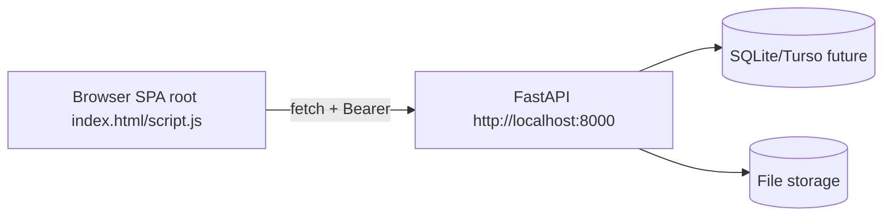
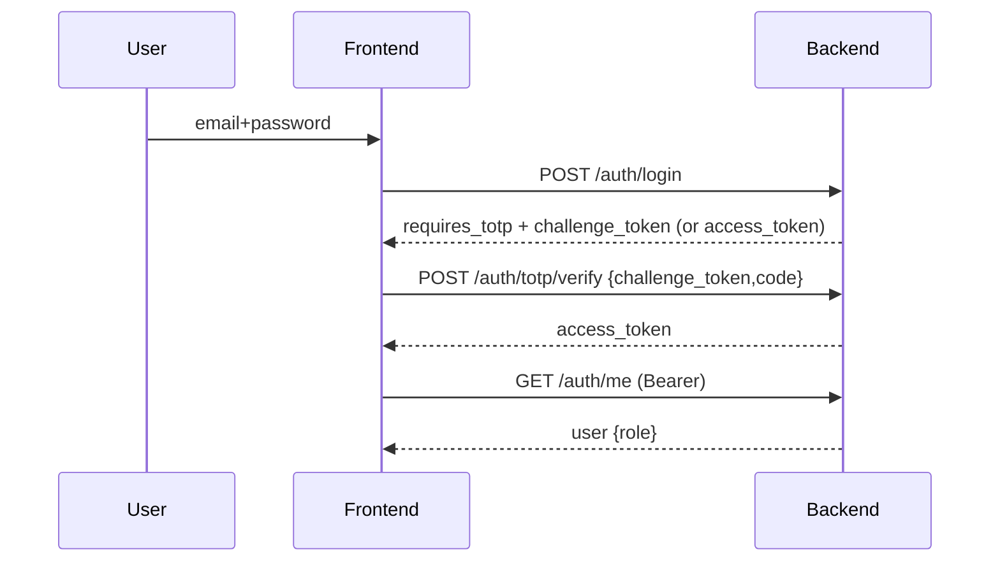
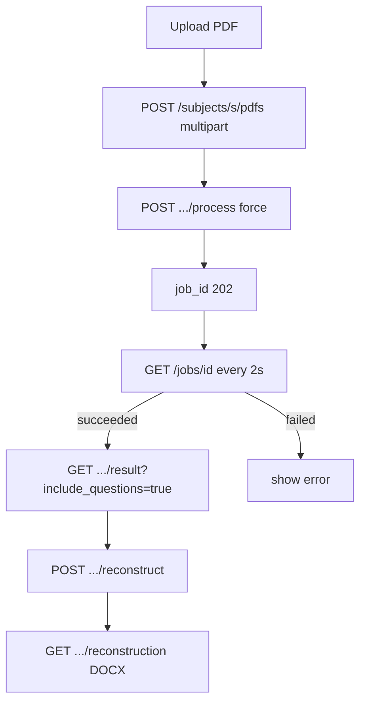
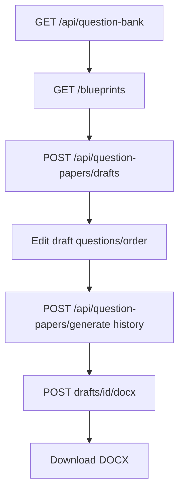

# MasterDeOrca — Frontend Architecture and Backend Communication

This document describes the **actual frontend implementation** found in this repository and how it communicates with the FastAPI backend. Details are derived from source inspection (`index.html`, `script.js`, `frontend/`, API modules, and `config.js`). No endpoints, components, or fields were invented.

Status legend used throughout:
- **CURRENT IMPLEMENTATION** — exists and is wired in the shipped frontend.
- **PLANNED ARCHITECTURE** — documented/designed but not fully implemented.
- **NOT YET IMPLEMENTED** — absent from the codebase.

---

## 1. Frontend overview

### 1.1 Stack
- **CURRENT IMPLEMENTATION**: Plain HTML/CSS/JavaScript single-page application (SPA). No build step, no framework (no React/Vue/Angular), no bundler. Served as static files.
- Two parallel frontends exist:
  - **Root frontend** (`index.html`, `script.js`, `style.css`, `styles/glass.css`) — the production SPA referenced by README/vercel/_redirects. All page logic, state, and API calls live here. **This is the actual frontend.**
  - **Modular frontend** (`frontend/`) — a redesign with ES modules (`frontend/js/*`, `frontend/css/*`) plus `frontend/index.html`. It contains an API client, auth/subjects/question-bank/teachers API modules, sidebar, router skeleton, notifications, and utils, but **no page controllers**. It is **PLANNED/PARTIAL** and not the served entry point.
- State is kept in module/global variables in `script.js`; persistence is `sessionStorage` (token) only. There is no client-side database and no direct Turso access — all data comes from backend APIs.

### 1.2 Directory organization (root frontend)
```
/
├── index.html          # SPA shell: login + all page sections + dialogs
├── script.js           # All logic: API helper, routing, state, pages, polling
├── style.css           # Main stylesheet
├── styles/glass.css    # Glass theme
├── tests/pyq-status.test.js
├── vercel.json         # SPA route rewrites → /index.html
└── _redirects          # Netlify-style rewrites
```
Modular (incomplete) tree:
```
frontend/
├── index.html
├── README.md
├── css/   # tokens/base/layout/components/pages/responsive
├── js/
│   ├── app.js, config.js
│   ├── api/ (api-client, auth, subjects, question-bank, teachers)
│   ├── core/ (router, notifications)
│   ├── components/ (sidebar)
│   └── utils/ (dom, errors, validators, formatters)
└── assets/
```

### 1.3 Routing
- **CURRENT IMPLEMENTATION**: History API based. `routeByPage` maps page ids to paths (`/dashboard`, `/subjects`, `/question-bank`, `/pyqs`, `/generate-paper`, `/my-papers`, `/teachers`, `/profile`, `/help`, `/activity`). `vercel.json`/`_redirects` rewrite all these to `/index.html`.
- `resolveRoute(pathname)` picks the page id for a path, preferring admin/teacher variants by role. Admin-only paths (`/teachers`, `/activity`, `/subjects`, `/pyqs`) return `null` for non-admins.
- `navigateToPage` uses `pushState`/`replaceState` and calls `showPage`. Browser back/forward handled via `popstate`.

### 1.4 Pages / major screens
| Page id | Route | Purpose |
|---|---|---|
| loginPage | /login | Email+password, then TOTP |
| teacher-dashboard / admin-dashboard | /dashboard | Stats, subjects, quick actions |
| teacher-subjects / admin-subjects | /subjects | Subject CRUD |
| teacher-questions | /question-bank | Parsed question bank |
| teacher-pyqs | /pyqs | PDF upload/process/result/reconstruct |
| teacher-generate | /generate-paper | Blueprint + generation + draft review |
| teacher-papers / admin-papers | /my-papers | Generated paper history |
| admin-teachers | /teachers | Teacher CRUD + access mode |
| teacher-profile / admin-profile | /profile | Profile + TOTP settings |
| teacher-help | /help | Help cards |
| admin-activity | /activity | (no backend endpoint) |

---

## 2. State management and data fetching

- **CURRENT IMPLEMENTATION**: No formal store. State is module-scoped `let` variables: `currentUser`, `subjects`, `subjectsLoadPromise`, `pyqSubject`, `pyqTable`, polling timers, `generatedDraft`, blueprint/config state, pagination cursors (`teachersPage`, `papersPage`, etc.).
- Data fetching is centralized through `api(path, options)` → `apiRequest` (fetch wrapper). It attaches `Authorization: Bearer <token>` from `sessionStorage`, sets `Content-Type: application/json` for bodies, supports `form: FormData` for multipart, parses JSON/text/blob, and converts errors to `Error` with `.status`.
- 401 clears the session and triggers `onUnauthorized`; 403 yields permission message. Network failures throw "Cannot reach server at …".
- Loading/empty/error states are rendered with helpers `stateHTML`, `tableStateHTML`, `pendingNote`, `setButtonLoading`.

---

## 3. API client configuration and backend base URL

- **CURRENT IMPLEMENTATION**:
  - `const API_BASE = (window.QPG_API_BASE || window.QPG_API_URL || "http://localhost:8000").replace(/\/+$/, "");`
  - Token key `qpg_token` in `sessionStorage`.
  - Override before script load via `window.QPG_API_BASE`.
- Modular frontend (`frontend/js/config.js`) uses the same expression with `API_BASE`/`TOKEN_KEY`.
- **Ports**: frontend served on `http://localhost:3000` (per README); backend on `http://localhost:8000`.

---

## 4. Authentication and authorization integration

- Login flow (CURRENT):
  1. `POST /auth/login` with `{email, password}` (skipAuth).
  2. If response has `requires_totp === true`, reveal OTP field, store `challenge_token`.
  3. `POST /auth/totp/verify` with `{challenge_token, code}` (skipAuth). On expired/reused challenge (401 detail matching `/challenge…(expir|reus|invalid)/`), silently re-login and retry the code once.
  4. On success, store `access_token` via `setToken`; then `GET /auth/me`.
- `GET /auth/me` populates `currentUser` (name, email, role, status). Role drives admin vs teacher UI and admin-only route gating.
- Access mode: `GET /auth/access-mode`, `PUT /auth/access-mode {mode}` ("read_only"/"edit"). Falls back to Edit Mode with a notice if endpoint missing (PLANNED backend, see S32).
- TOTP management (profile): `GET /auth/totp/status`, `POST /auth/totp/enroll`, `POST /auth/totp/confirm {code}`, `DELETE /auth/totp {code}`. 429 handling uses `Retry-After`.
- Logout: client-side only (clear session). No backend logout endpoint.
- **Authorization**: Bearer token on all except login/verify/health. Admin pages additionally require admin role; non-admins are blocked from `/subjects`, `/pyqs`, `/teachers`, `/activity`.

---

## 5. Subject selection and document (PDF) management

- Subjects are enumerated via `GET /subjects` (admin-only on backend; teachers fall back to blueprint `subject_id`s).
- Subject CRUD: `POST /subjects {name}`, `PATCH /subjects/{subject} {name}`, `DELETE /subjects/{subject}`.
- PDFs per subject: `GET /subjects/{subject}/pdfs` returns list with `filename, size_bytes, status, job_id, result_available, review_status, question_count, …`.
- Upload: `POST /subjects/{subject}/pdfs` multipart `files` (repeated). Response field is `uploaded` (frontend previously expected other keys — corrected to `uploaded`).
- Review status: `PATCH /subjects/{subject}/pdfs/{filename} {review_status}`.
- Delete PDF: `DELETE /subjects/{subject}/pdfs/{filename}`.
- Subject dropdowns drive PYQ, Question Bank, and Generate pages.

---

## 6. PDF upload and processing workflow

- **CURRENT IMPLEMENTATION**:
  1. Select subject → list PDFs.
  2. Upload PDFs (multipart).
  3. Click Process → `POST /subjects/{subject}/pdfs/{filename}/process {force:true}` → 202 `{job_id, status, subject, filename}`.
  4. Poll `GET /jobs/{job_id}` every 2s until `succeeded`/`failed`; then reload PDF list.
  5. On success, view result via `GET /subjects/{subject}/pdfs/{filename}/result?include_questions=true`.
  6. Reconstruct DOCX via `POST …/reconstruct`, then download `GET …/reconstruction`.
- OCR: backend may return 503 if GPU OCR unavailable; frontend surfaces error.

---

## 7. Job polling, progress indicators and error handling

- Polling loop uses `setInterval`/recursive `setTimeout` (2000ms). Terminal states stop polling and refresh list.
- Status values handled: `queued, running, succeeded, failed, not_processed`.
- Progress: status pill/badge plus stage text from job payload.
- Errors: toast + inline; 409 conflicts, 404 missing, 422 validation, 503 OCR. `setButtonLoading` disables buttons during requests.
- Empty states: "Select a subject…", "No questions found", etc.

---

## 8. Question Bank (parsed) fetching, displaying, editing, updating

- List: `GET /api/question-bank?subject_id=&marks=&page=&page_size=`. Response `{items, pagination, filters, available_marks}`. Frontend uses `available_marks` to populate marks filter.
- Detail: `GET /api/question-bank/{question_id}?subject_id=`.
- Resources: `GET /api/question-bank/{id}/resources/{content_type}/{resource_id}?subject_id=` (figure → base64 image; table → headers/rows).
- Create: `POST /api/question-bank` with `{subject_id, cleaned_text, marks, section_name, original_question_number, source_pdf, source_pages, page_number, priority}`.
- Update: `PATCH /api/question-bank/{id}?subject_id=` with subset.
- Delete: `DELETE /api/question-bank/{id}?subject_id=` (proposed backend; frontend calls and shows error until available).
- Priorities: `GET /api/question-priorities?subject_id=`, `PUT /api/question-priorities {question_id, priority, subject_id}`, `DELETE /api/question-priorities/{id}?subject_id=`.
- Approve/reject (proposed): `POST /api/question-bank/{id}/approve`, `POST /api/question-bank/{id}/reject`.
- Validation pipeline fields (`validation_status`, `validation_reason`, `processing_status`) consumed when present; absent → legacy behavior (S33).

Display: grouped by marks, priority sort, pagination (10/25/50), priority dots 1/2/3, source metadata, figure/table preview modal.

---

## 9. How each major screen obtains and displays backend data

| Screen | Data source | Calls |
|---|---|---|
| Login | auth | `/auth/login`, `/auth/totp/verify` |
| Dashboard | subjects, teachers count | `/subjects`, `/teachers?page=1&page_size=1` |
| Subjects | subjects, PDFs | `/subjects`, `/subjects/{s}/pdfs`, upload/process/result/reconstruct |
| Question Bank | bank | `/api/question-bank`, priorities, resources |
| PYQs | PDFs | `/subjects/{s}/pdfs`, upload, process, result, reconstruct, review, delete |
| Generate Paper | subjects, blueprints, bank, configs | `/subjects`, `/blueprints`, `/api/question-bank`, `/api/ui-configurations`, `/api/question-papers/drafts`, `/api/question-papers/generate` |
| My Papers / Question Papers | history | `/api/question-papers/history`, download, delete |
| Admin | teachers, access mode | `/teachers`, `/auth/access-mode` |
| Profile | me, totp | `/auth/me`, `/auth/totp/*` |

---

## 10. Request methods, payloads, response handling, endpoint dependencies

See `backend_services.md` and `BACKEND_FRONTEND_INTEGRATION.md` for full backend contract. Frontend dependencies:
- Question Bank depends on parsed PDF results synced to backend bank.
- Paper generation depends on Question Bank + Blueprints.
- Drafts depend on Question Bank and blueprints.
- UI configurations and access-mode are backend-persisted (proposed).
- History records are created automatically on generate.

---

## 11. Loading, empty, error, success states

- **Loading**: button spinners (`setButtonLoading`), "Loading subjects…", table state cells.
- **Empty**: "Select a subject…", "No questions found", empty pagination hidden.
- **Error**: toast + inline messages; `stateHTML` with icon; Retry buttons.
- **Success**: success header card, toast, DOCX download blob.

---

## 12. Backend communication — endpoints currently used by frontend

### Authentication
| Method | Endpoint | Caller | Payload | Response |
|---|---|---|---|---|
| POST | `/auth/login` | login form | `{email,password}` | `{access_token,token_type,requires_totp?,challenge_token?}` |
| POST | `/auth/totp/verify` | TOTP step | `{challenge_token,code}` | `{access_token}` |
| GET | `/auth/me` | app load | — | user object |
| GET | `/auth/access-mode` | admin | — | `{mode,updated_at}` |
| PUT | `/auth/access-mode` | admin | `{mode}` | `{mode,updated_at}` |
| GET | `/auth/totp/status` | profile | — | status |
| POST | `/auth/totp/enroll` | profile | — | enrollment |
| POST | `/auth/totp/confirm` | profile | `{code}` | result |
| DELETE | `/auth/totp` | profile | `{code}` | result |

### Subjects & PDFs
| Method | Endpoint | Caller | Payload/Params | Response |
|---|---|---|---|---|
| GET | `/subjects` | dashboard/subjects/pyqs/generate | — | `{subjects}` |
| POST | `/subjects` | subjects page | `{name}` | `{name,created,directories}` |
| PATCH | `/subjects/{subject}` | subjects page | `{name}` | `{name,renamed}` |
| DELETE | `/subjects/{subject}` | subjects page | — | 204 |
| GET | `/subjects/{subject}/pdfs` | pyqs | — | `{subject,pdfs:[{filename,size_bytes,status,job_id,result_available,review_status,question_count,…}]}` |
| POST | `/subjects/{subject}/pdfs` | pyqs upload | multipart `files` | `{subject,uploaded:[{filename,size_bytes,path}]}` |
| DELETE | `/subjects/{subject}/pdfs/{filename}` | pyqs | — | 204 |
| PATCH | `/subjects/{subject}/pdfs/{filename}` | pyqs review | `{review_status}` | item |
| POST | `/subjects/{subject}/pdfs/{filename}/process` | pyqs | `{force}` | `{job_id,status,subject,filename}` |
| GET | `/jobs/{job_id}` | polling | — | job payload |
| GET | `/subjects/{subject}/pdfs/{filename}/status` | pyqs | — | job or not_processed |
| GET | `/subjects/{subject}/pdfs/{filename}/result?include_questions=true` | pyqs | query | `{subject,filename,parsed_json,question_count,metadata,questions}` |
| POST | `/subjects/{subject}/pdfs/{filename}/reconstruct` | pyqs | — | `{docx_path,question_count,subquestion_count,figures_inserted,warnings,missing_assets}` |
| GET | `/subjects/{subject}/pdfs/{filename}/reconstruction` | pyqs download | — | DOCX blob |

### Question Bank & priorities
| Method | Endpoint | Caller | Payload/Params | Response |
|---|---|---|---|---|
| GET | `/api/question-bank` | QB page/generate | `subject_id,marks,page,page_size` | `{items,pagination,filters,available_marks}` |
| GET | `/api/question-bank/{id}` | detail | `subject_id` | question detail |
| POST | `/api/question-bank` | QB add | question fields | created item |
| PATCH | `/api/question-bank/{id}` | QB edit | subset fields | updated item |
| DELETE | `/api/question-bank/{id}` | QB remove | `subject_id` | 204 (proposed backend) |
| GET | `/api/question-bank/{id}/resources/{type}/{rid}` | figure/table preview | `subject_id` | figure/table payload |
| GET | `/api/question-priorities` | QB | `subject_id` | `{subject_id,default_priority,priorities}` |
| PUT | `/api/question-priorities` | QB | `{question_id,priority,subject_id}` | `{question_id,subject_id,priority,updated}` |
| DELETE | `/api/question-priorities/{id}` | QB | `subject_id` | `{question_id,subject_id,priority,reset}` |
| POST | `/api/question-bank/{id}/approve` | QB review | `{}` | item (proposed) |
| POST | `/api/question-bank/{id}/reject` | QB review | `{}` | item (proposed) |

### Teachers
| Method | Endpoint | Caller | Payload/Params |
|---|---|---|---|
| GET | `/teachers` | admin | `status,search,page,page_size` |
| POST | `/teachers` | admin | `{name,email,department,password,status}` |
| PATCH | `/teachers/{id}` | admin | subset |
| DELETE | `/teachers/{id}` | admin | — |

### Blueprints
| Method | Endpoint | Caller | Payload |
|---|---|---|---|
| GET | `/blueprints` | generate | — |
| POST | `/blueprints` | generate | `{blueprint_id,name,description,subject_id,exam_type,sections,is_default}` |
| PATCH | `/blueprints/{id}` | generate | subset |
| DELETE | `/blueprints/{id}` | generate | — |
| POST | `/blueprints/{id}/duplicate` | generate | optional/null |

### Question papers / drafts / history
| Method | Endpoint | Caller | Payload |
|---|---|---|---|
| POST | `/api/question-papers/drafts` | generate | `QuestionPaperGenerate` body (title,subject,exam_type,total_marks,duration,blueprint_id,seed,metadata) |
| GET | `/api/question-papers/drafts/{draft_id}` | generate | — |
| POST | `/api/question-papers/drafts/{draft_id}/questions` | draft review | `{question_id,section}` |
| PATCH | `/api/question-papers/drafts/{draft_id}/questions/{qid}` | draft review | `{text,marks,section}` |
| DELETE | `/api/question-papers/drafts/{draft_id}/questions/{qid}` | draft review | — |
| PUT | `/api/question-papers/drafts/{draft_id}/question-order` | draft review | `{question_ids}` |
| POST | `/api/question-papers/drafts/{draft_id}/docx` | export | `{}` (DraftDocxExport) |
| POST | `/api/question-papers/generate` | history | same body |
| GET | `/api/question-papers/history` | my papers | `page,page_size,subject` |
| GET | `/api/question-papers/{paper_id}/docx` | download | — |
| DELETE | `/api/question-papers/history/{paper_id}` | delete | — |

### UI configurations (proposed backend)
| Method | Endpoint | Caller | Payload |
|---|---|---|---|
| GET | `/api/ui-configurations` | generate | — |
| POST | `/api/ui-configurations` | generate | `{name,values,is_default}` |
| PATCH | `/api/ui-configurations/{id}` | generate | subset |
| DELETE | `/api/ui-configurations/{id}` | generate | — |

---

## 13. Unused endpoints, mismatched payloads, outdated calls, inconsistencies

1. **Modular frontend (`frontend/`) is incomplete**: it only has API clients and no page controllers; root `script.js` is the real implementation. Treating `frontend/` as production would be incorrect.
2. **UI configurations (`/api/ui-configurations`) and access-mode (`/auth/access-mode`) and question-bank delete/approve/reject** are called by the frontend but backend implementation status varies (proposed/pending). Pages show live errors rather than faking data.
3. **Backend has many endpoints not used by frontend**: `/health`, `/subjects/{s}/topics`, `/questions`, `/papers`, `/subjects/{s}/weightage`, import endpoint, reconstruction download for PDFs (used), etc. The frontend does not call topics/questions/papers/weightage/import (marked obsolete/superseded).
4. **Legacy vs JSON bank**: frontend uses `/api/question-bank` (JSON bank), not legacy `/questions` (SQLite). Both exist in backend; frontend migrated to JSON bank.
5. **Blueprint contract drift**: earlier docs (S25) used `/papers/generate`, `sections[{name,questions,marks}]`, `download_url`. Actual (S26) uses `/api/question-papers/generate` (or drafts), `blueprint_id`, and `/api/question-papers/{paper_id}/docx`. Frontend migrated to S26.
6. **Upload response key**: frontend now reads `data.uploaded` (was expecting `files`/`pdfs`/`stored`).
7. **Admin-only subjects**: `/subjects` is admin-only; teachers derive subjects from blueprints. Frontend handles both.
8. **No `/health` polling** in frontend despite backend exposing it.
9. **Instructions field**: collected in UI (`paperInstructions`) but not included in `requestBody` sent to backend (metadata not persisted) — backend schema has no instructions field in `QuestionPaperGenerate` beyond title/exam. Mismatch to note, not corrected.
10. **Role claim**: JWT has no role claim; frontend relies on `/auth/me`. Fallback assumes admin until `/auth/me` resolves.
11. **No refresh tokens**: frontend re-logs in on 401.
12. **Drafts listing**: backend has no list endpoint; frontend shows a static note.

---

## 14. Localhost and future cloud transition

### Current configuration
- Frontend URL: `http://localhost:3000`
- Backend URL: `http://localhost:8000`
- API base: `window.QPG_API_BASE || window.QPG_API_URL || "http://localhost:8000"` (trailing slash stripped).
- CORS: backend default origins `http://localhost:3000,http://localhost:5173`; methods GET/POST/PUT/PATCH/DELETE/OPTIONS; headers Authorization, Content-Type.
- Connection: browser `fetch(API_BASE + path)` with Bearer token. FastAPI on uvicorn.

### Future cloud transition (PLANNED, not implemented)
- Set `window.QPG_API_BASE` to cloud backend URL (or build-time env) instead of localhost.
- Update backend `QUES_CORS_ORIGINS` to include deployed frontend origin.
- Keep frontend talking to backend APIs only; **do not** connect frontend to Turso directly. Turso SQLite is backend-side future DB.
- Auth token storage may need hardening (httpOnly cookies) but current uses sessionStorage.
- File downloads (DOCX) rely on backend streaming; ensure cloud storage/egress.

---

## 15. Docker preparation (future, not implemented)

- **Frontend container**: serve static files (nginx or similar) on a port; inject `QPG_API_BASE` at runtime/build.
- **Backend container**: FastAPI/uvicorn image with env vars (JWT secret, storage, DB, CORS). Separate container.
- **Connectivity**: frontend container → backend container via env-based API URL (not localhost in prod). In local docker compose, use service names.
- **Assets**: PDFs/DOCX stored on backend volume; frontend never stores files.
- No Docker files are created by this documentation; deployment config unchanged.

---

## 16. Mermaid diagrams

### Frontend → backend communication


### Authentication flow


### PDF processing flow


### Question Bank → paper generation flow


---

## 17. Verification notes

- Verified against `script.js` (5397 lines), `frontend/` modules, `index.html`, `vercel.json`, `_redirects`, `README.md`, `for_ui_developers.md`, `backend_services.md`, `BACKEND_FRONTEND_INTEGRATION.md`.
- Endpoints listed are those actually called by the frontend (grep of `api(`/`apiRequest(`). Backend-only endpoints are not claimed as integrated.
- Contract mismatches are listed in section 13 rather than silently corrected.
- No application code, API contracts, DB logic, or UI behavior was modified. Documentation only.
