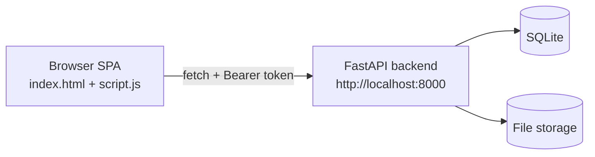

# Architecture

This document describes the real frontend architecture found in the repository.

## 1. Active frontend

The shipped frontend is a plain HTML/CSS/JavaScript single-page app (SPA). There is no build step, no framework, and no bundler. It is served as static files.

Active files:

- `index.html` — app shell: login screen, all page sections, dialogs.
- `script.js` — all logic: API helper, routing, state, pages, polling.
- `style.css` — main stylesheet.
- `styles/glass.css` — glass theme.

A second tree, `frontend/`, contains a modular redesign (ES modules under `frontend/js/`, styles under `frontend/css/`). It has API clients, a sidebar, a router skeleton, notifications, and utils, but **no page controllers**. It is incomplete and is **not** the served entry point. Do not treat it as active.

## 2. Overall data flow

The frontend never talks to the database or file storage directly. All data comes from backend APIs.

## 3. Routing

Routing uses the History API. `routeByPage` in `script.js` maps page ids to paths (`/dashboard`, `/subjects`, `/question-bank`, `/pyqs`, `/generate-paper`, `/my-papers`, `/teachers`, `/profile`, `/help`, `/activity`). `vercel.json` and `_redirects` rewrite all of these to `/index.html`.

`resolveRoute(pathname)` picks the page id for a path, preferring admin or teacher variants by role. Admin-only paths (`/teachers`, `/activity`, `/subjects`, `/pyqs`) return `null` for non-admins. Browser back/forward is handled via `popstate`.

## 4. State management

There is no formal store. State is module-scoped `let` variables in `script.js`, for example `currentUser`, `subjectsCache`, `pyqPdfItems`, `generatedDraft`, `currentUserPermissions`, and pagination cursors. Persistence is `sessionStorage` (token) only.

## 5. API client

Data fetching is centralized in `api()` / `apiRequest()` in `script.js`. It:

- Attaches `Authorization: Bearer <token>` from `sessionStorage`.
- Sets `Content-Type: application/json` for JSON bodies.
- Supports `form: FormData` for multipart uploads.
- Parses JSON, text, or blob responses.
- On `401`, clears the session and calls `onUnauthorized` (returns to login).
- On `403`, shows a permission message.

## 6. Backend base URL

The base URL resolves from (in order): `window.QPG_API_BASE`, `window.QPG_API_URL`, the `meta[name="qpg-api-base"]` tag, or `http://localhost:8000`. The sidebar also lets the user switch between the local (Docker) and production (Render) backend; switching clears the session and reloads.

## 7. Pages / major screens

| Page id | Route | Purpose |
|---|---|---|
| loginPage | /login | Email + password, then TOTP |
| teacher-dashboard / admin-dashboard | /dashboard | Stats, subjects, quick actions |
| teacher-subjects / admin-subjects | /subjects | Subject CRUD (admin) |
| teacher-questions | /question-bank | Parsed question bank |
| teacher-pyqs | /pyqs | PDF upload, process, result, reconstruct |
| teacher-generate | /generate-paper | Blueprint + generation + draft review |
| teacher-papers / admin-papers | /my-papers | Generated paper history |
| admin-teachers | /teachers | Teacher CRUD + access mode + assignments |
| teacher-profile / admin-profile | /profile | Profile + TOTP settings |
| teacher-help | /help | Help cards |
| admin-activity | /activity | (no backend endpoint) |

## 8. UI state helpers

Loading, empty, and error states are rendered with `stateHTML`, `tableStateHTML`, `pendingNote`, and `setButtonLoading`. Toasts are shown with `showToast`.

## 9. Legacy / unused code

- The `frontend/` modular tree is incomplete (no page controllers). It is not loaded by `index.html`.
- Backend endpoints for topics, questions (DB), papers (DB), weightage, and import exist but the frontend does not call them (superseded by the JSON question bank).
- `/settings` is listed in `vercel.json` but has no page section.
## Related documentation

- [Frontend structure](frontend-structure.md)
- [Application flow](application-flow.md)
- [Backend integration](backend-integration.md)

