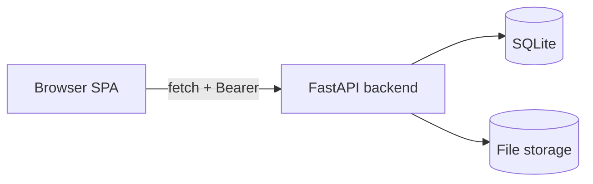

# Backend integration

## 1. Base URL and client

- Default: `http://localhost:8000`.
- Production: `https://qpengine-6f07.onrender.com` (switchable in the sidebar).
- Override via `window.QPG_API_BASE`, `window.QPG_API_URL`, or `meta[name="qpg-api-base"]`.
- All requests use `api()` / `apiRequest()` in `script.js`, which attaches `Authorization: Bearer <token>`.

## 2. CORS

Backend allows origins from `QUES_CORS_ORIGINS` (default `http://localhost:3000,http://localhost:5173`), methods GET/POST/PUT/PATCH/DELETE/OPTIONS, headers Authorization and Content-Type. The frontend must be served from an allowed origin.

## 3. Endpoints used by the frontend

### Authentication
| Method | Endpoint | Purpose |
|---|---|---|
| POST | `/auth/login` | Login `{email,password}` |
| POST | `/auth/totp/verify` | Verify TOTP `{challenge_token,code}` |
| GET | `/auth/me` | Current user |
| GET | `/auth/access-mode` | Admin access mode |
| PUT | `/auth/access-mode` | Set access mode `{mode}` |
| GET | `/auth/totp/status` | TOTP status |
| POST | `/auth/totp/enroll` | Start TOTP enrollment |
| POST | `/auth/totp/confirm` | Confirm TOTP `{code}` |
| DELETE | `/auth/totp` | Disable TOTP `{code}` |

### Subjects and PDFs
| Method | Endpoint | Purpose |
|---|---|---|
| GET | `/subjects` | List subjects (admin) |
| POST | `/subjects` | Create subject `{name}` |
| PATCH | `/subjects/{subject}` | Rename `{name}` |
| DELETE | `/subjects/{subject}` | Delete subject |
| GET | `/subjects/{subject}/pdfs` | List PDFs |
| POST | `/subjects/{subject}/pdfs` | Upload PDFs (multipart `files`) |
| DELETE | `/subjects/{subject}/pdfs/{filename}` | Delete PDF |
| PATCH | `/subjects/{subject}/pdfs/{filename}` | Set review status `{review_status}` |
| POST | `/subjects/{subject}/pdfs/{filename}/process` | Start processing `{force}` |
| GET | `/jobs/{job_id}` | Job status |
| GET | `/subjects/{subject}/pdfs/{filename}/status` | PDF status |
| GET | `/subjects/{subject}/pdfs/{filename}/result` | Parsed result (`?include_questions=true`) |
| POST | `/subjects/{subject}/pdfs/{filename}/reconstruct` | Reconstruct DOCX |
| GET | `/subjects/{subject}/pdfs/{filename}/reconstruction` | Download DOCX |

### Question Bank and priorities
| Method | Endpoint | Purpose |
|---|---|---|
| GET | `/api/question-bank` | List questions (`subject_id,marks,page,page_size`) |
| GET | `/api/question-bank/{id}` | Question detail (`?subject_id=`) |
| POST | `/api/question-bank` | Create question |
| PATCH | `/api/question-bank/{id}` | Update question |
| DELETE | `/api/question-bank/{id}` | Delete (proposed backend) |
| GET | `/api/question-bank/{id}/resources/{type}/{rid}` | Figure/table resource |
| GET | `/api/question-priorities` | Get priorities |
| PUT | `/api/question-priorities` | Set priority |
| DELETE | `/api/question-priorities/{id}` | Reset priority |
| POST | `/api/question-bank/{id}/approve` | Approve (proposed) |
| POST | `/api/question-bank/{id}/reject` | Reject (proposed) |

### Teachers
| Method | Endpoint | Purpose |
|---|---|---|
| GET | `/teachers` | List teachers |
| POST | `/teachers` | Create teacher |
| PATCH | `/teachers/{id}` | Update teacher |
| DELETE | `/teachers/{id}` | Delete teacher |
| GET/POST | `/users/{id}/subjects`, `/teachers/{id}/subjects` | Subject assignments |
| PUT | `/users/{id}/subjects/{subject}/permissions` | Set permissions (available, not called by simplified UI) |

### Blueprints
| Method | Endpoint | Purpose |
|---|---|---|
| GET | `/blueprints` (or `/api/question-paper/blueprints`) | List blueprints |
| GET | `/blueprints/{id}` | Get blueprint |
| POST | `/blueprints` | Create blueprint |
| PATCH/PUT | `/blueprints/{id}` | Update blueprint |
| POST | `/blueprints/{id}/duplicate` | Duplicate |
| DELETE | `/blueprints/{id}` | Delete |

### Question papers and drafts
| Method | Endpoint | Purpose |
|---|---|---|
| POST | `/api/question-papers/drafts` | Create draft |
| GET | `/api/question-papers/drafts/{draft_id}` | Get draft |
| PATCH | `/api/question-papers/drafts/{draft_id}` | Update draft |
| POST | `/api/question-papers/drafts/{draft_id}/questions` | Add question |
| PATCH | `/api/question-papers/drafts/{draft_id}/questions/{qid}` | Edit question |
| DELETE | `/api/question-papers/drafts/{draft_id}/questions/{qid}` | Remove question |
| PUT | `/api/question-papers/drafts/{draft_id}/question-order` | Reorder |
| POST | `/api/question-papers/drafts/{draft_id}/docx` | Export DOCX |
| POST | `/api/question-papers/generate` | Generate paper |
| GET | `/api/question-papers/history` | Paper history |
| GET | `/api/question-papers/{paper_id}/docx` | Download DOCX |
| DELETE | `/api/question-papers/history/{paper_id}` | Delete paper |

### UI configurations (proposed backend)
| Method | Endpoint | Purpose |
|---|---|---|
| GET/POST/PATCH/DELETE | `/api/ui-configurations` | Saved paper configurations |

## 4. Known mismatches and pending items

1. **Modular frontend (`frontend/`)** is incomplete — not active.
2. **UI configurations, access-mode, question-bank delete/approve/reject** are called by the frontend but backend status varies; pages show live errors rather than faking data.
3. **Backend has endpoints not used by the frontend**: `/health`, topics, questions (DB), papers (DB), weightage, import. The frontend uses the JSON question bank, not the legacy DB system.
4. **Blueprint contract drift**: earlier docs used `/papers/generate`; current uses `/api/question-papers/generate` and drafts. Frontend migrated.
5. **Upload response key**: frontend reads `data.uploaded`.
6. **Admin-only subjects**: `/subjects` is admin-only; teachers derive subjects from blueprints and permissions.
7. **Instructions field** is collected in the UI (`paperInstructions`) but is not included in the request body sent to the backend.
8. **No refresh tokens**; frontend re-logs in on 401.
9. **Drafts listing**: backend has no list endpoint; frontend shows a static note.
10. **Subject assignments** use `/users/{id}/subjects` and `/teachers/{id}/subjects` with fallbacks; backend status varies.
11. **Reconciliation controls** (`/admin/reconciliation/*`) are proposed and not implemented; see [reconciliation-contract.md](reconciliation-contract.md).
12. **Access-mode endpoint** may be missing; UI defaults to Edit Mode.

## 5. Error handling

Status codes used: 400 (bad request), 401 (unauthorized), 403 (forbidden), 404 (not found), 409 (conflict), 413 (too large), 415 (not PDF), 422 (validation). The frontend surfaces these via toasts and inline messages. Empty successful responses (e.g. empty question list) are not errors.

## 6. Mermaid: frontend-to-backend communication

## Related documentation

- [Architecture](architecture.md)
- [Authentication and permissions](authentication-permissions.md)
- [Development guide](development-guide.md)

