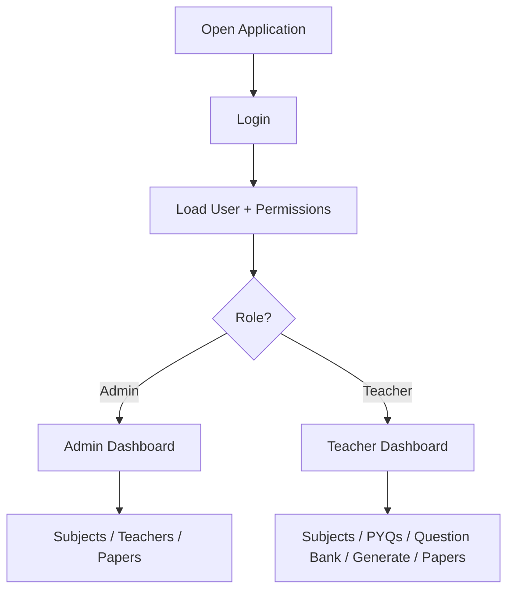
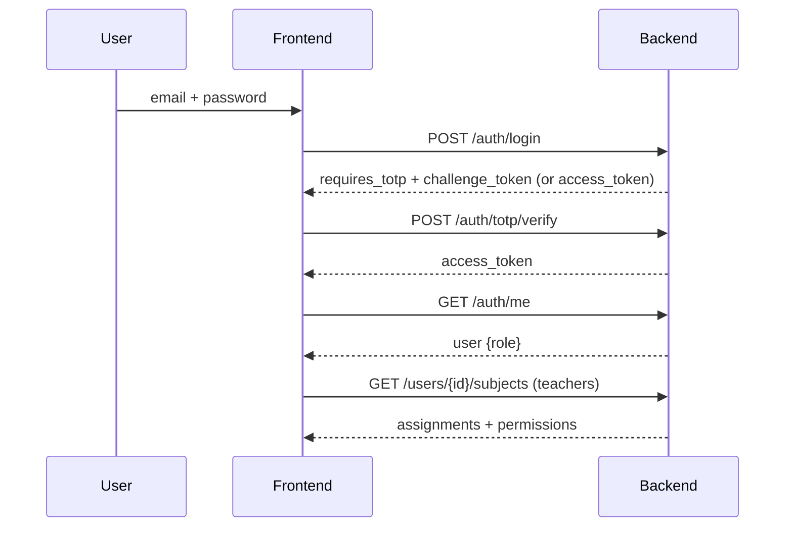
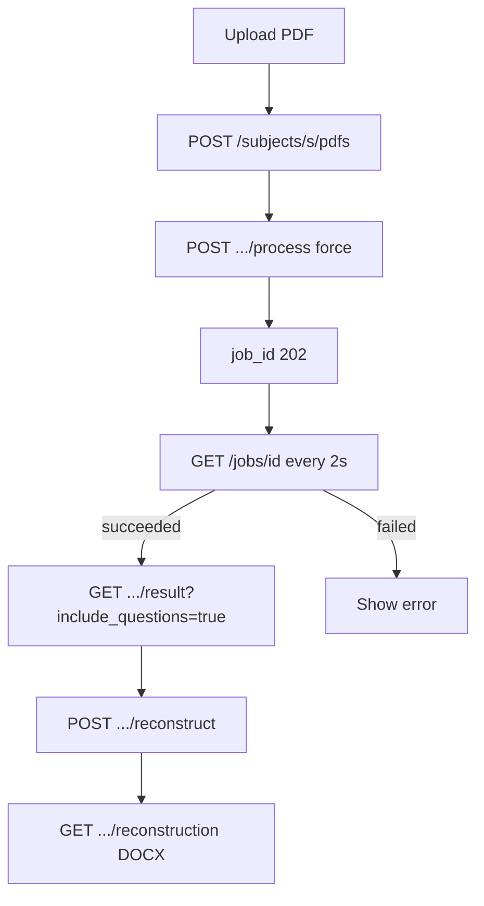
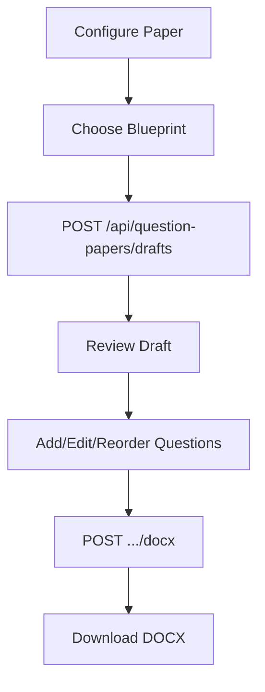
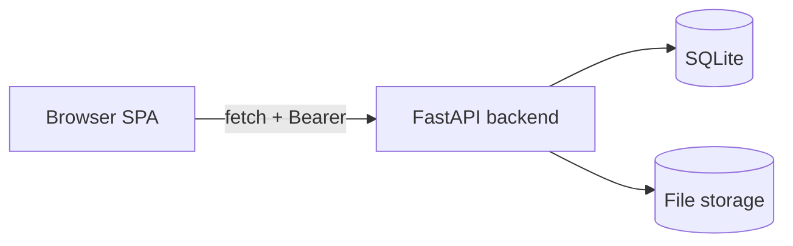

# Complete workflow

This document merges the scattered step-by-step guides into one user journey.

## 1. Open the application

The browser loads `index.html` and `script.js`. The backend base URL is resolved and probed. If a valid token exists in `sessionStorage`, the app shell is shown; otherwise the login page is shown.

## 2. Authentication

1. Enter email and password; submit the form.
2. `POST /auth/login`. On success without TOTP, a token is stored and the app opens.
3. If `requires_totp === true`, the TOTP field appears; enter the six-digit code.
4. `POST /auth/totp/verify` returns the token; `GET /auth/me` loads the user.

Admin and teacher accounts both log in the same way; the role comes from `/auth/me`.

## 3. Role and permission loading

- `isAdminUser()` checks `currentUser.role === "admin"`.
- Admins load the access mode (`GET /auth/access-mode`).
- Teachers load subject assignments and permissions (`GET /users/{id}/subjects`, fallback `/teachers/me/subjects`), building `currentUserPermissions`.

## 4. Subject selection

- **Admins:** `GET /subjects` lists all subjects; can create/rename/delete.
- **Teachers:** subjects come from blueprints plus `currentUserPermissions` keys (admin-only `/subjects` is not callable).

Selecting a subject drives the PYQ, Question Bank, and Generate pages.

## 5. Uploading question papers (PYQs)

Admins only (upload is admin-gated on the backend):

1. Select a subject on the PYQs page.
2. Upload PDFs/DOCX/images via `POST /subjects/{subject}/pdfs` (multipart `files`).
3. Click Process → `POST /subjects/{subject}/pdfs/{filename}/process {force:true}` → 202 with `job_id`.
4. Poll `GET /jobs/{job_id}` every 2s until `succeeded` or `failed`.
5. On success, view the result via `GET /subjects/{subject}/pdfs/{filename}/result?include_questions=true`.
6. Optionally reconstruct DOCX: `POST .../reconstruct` then download `GET .../reconstruction`.

## 6. Processing status and job tracking

Status values: `queued`, `running`, `succeeded`, `failed`, `not_processed`. Polling stops on terminal states and the PDF list refreshes. Errors surface via toasts and inline messages.

## 7. Viewing extracted questions

Parsed questions appear in the PDF result and are synced to the Question Bank by the backend (`question_bank.sync_pdf()`).

## 8. Managing the Question Bank

1. Select subject and (optionally) marks on the Question Bank page.
2. `GET /api/question-bank?subject_id=&marks=&page=&page_size=`.
3. Browse, search, sort by priority, paginate (10/25/50).
4. Create/edit/delete questions; set priorities (`GET/PUT/DELETE /api/question-priorities`).
5. Preview figures/tables via resource endpoints.

## 9. Editing or managing questions

- Edit: `PATCH /api/question-bank/{id}?subject_id=`.
- Delete: `DELETE /api/question-bank/{id}?subject_id=` (backend proposed).
- Review panel shows items flagged for manual review (approve/reject proposed).

## 10. Generating question papers

1. Open Generate Question Paper.
2. Fill basic configuration (title, subject, exam type, duration, total marks, ...).
3. Choose/edit a blueprint (sections: name, question count, marks each; totals must equal total marks).
4. Submit → `POST /api/question-papers/drafts` returns a draft.
5. Review/edit the draft (text, marks, section, order, add/remove questions).
6. Export DOCX: `POST /api/question-papers/drafts/{draft_id}/docx`.

Or generate directly with `POST /api/question-papers/generate` (creates a history record).

## 11. Viewing and managing generated results

- My Papers page: `GET /api/question-papers/history`.
- Download: `GET /api/question-papers/{paper_id}/docx`.
- Delete: `DELETE /api/question-papers/history/{paper_id}`.

## Conditional steps and role differences

- **Upload/process PYQs** is admin-only on the backend; teachers are gated by `uploadProcess` permission at the page level.
- **Subject CRUD** is admin-only.
- **Teacher management and access-mode** are admin-only.
- **Question Bank** and **Generate** are available to teachers with the right permissions (`manageBank`/`accessPapers`, `generate`).
- **Saved configurations and blueprints** are available to any authenticated user.
- Dashboard totals are computed from other endpoints (no metrics endpoint).

## Mermaid: main application navigation



## Mermaid: authentication and permission flow



## Mermaid: document upload and processing flow



## Mermaid: Question Bank workflow

```mermaid
flowchart TD
    S[Select Subject + Marks] --> L[GET /api/question-bank]
    L --> V[View / Search / Sort / Paginate]
    V --> E[Edit / Delete / Priority]
    E --> R[Review Panel (approve/reject)]
```

## Mermaid: paper generation workflow



## Mermaid: frontend-to-backend communication


## Related documentation

- [Application flow](application-flow.md)
- [Authentication and permissions](authentication-permissions.md)
- [Backend integration](backend-integration.md)

